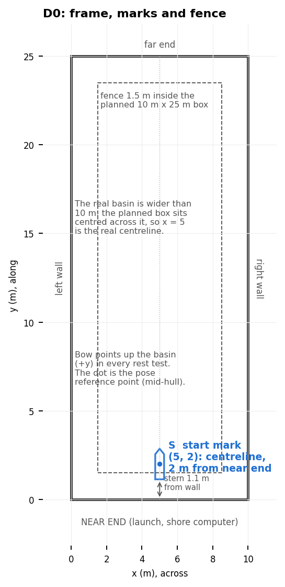
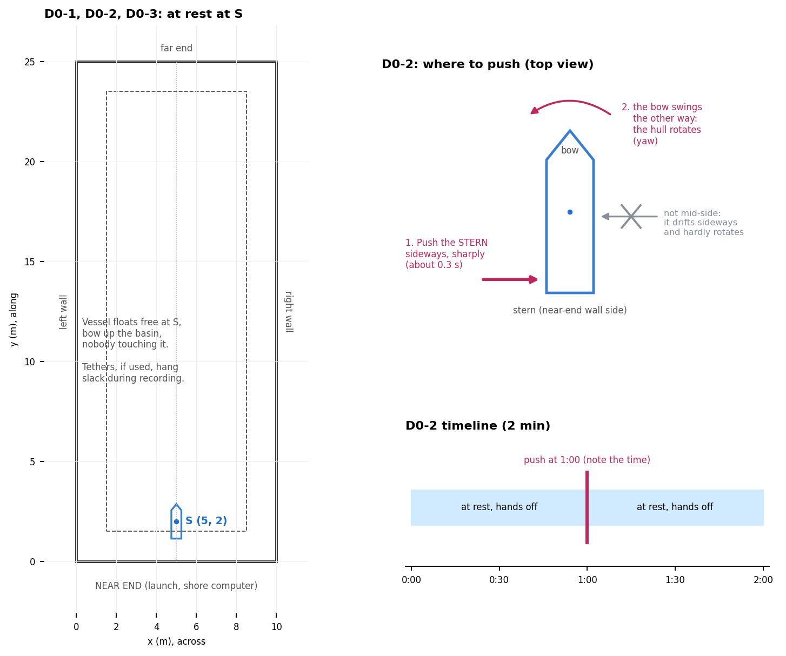
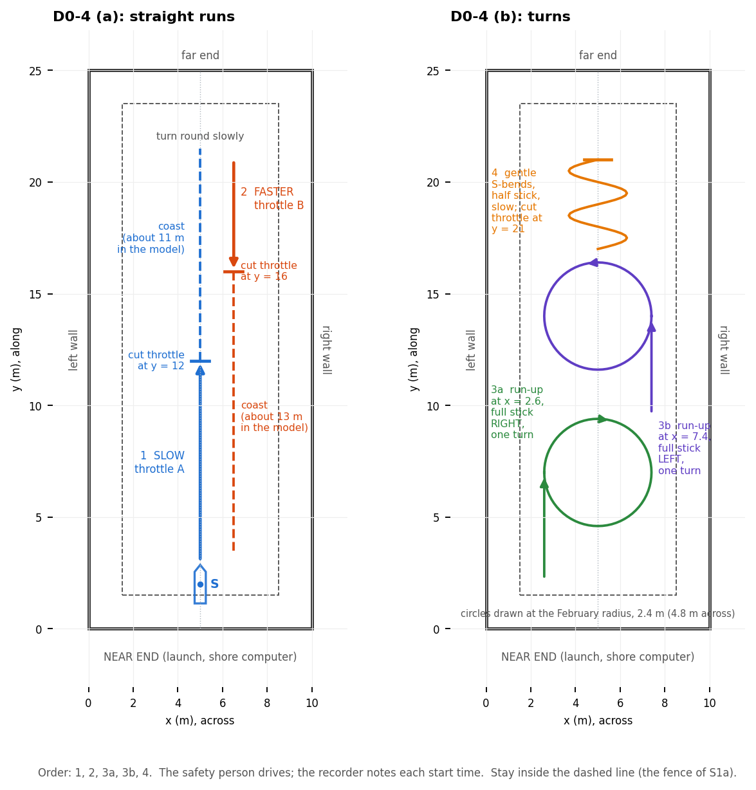
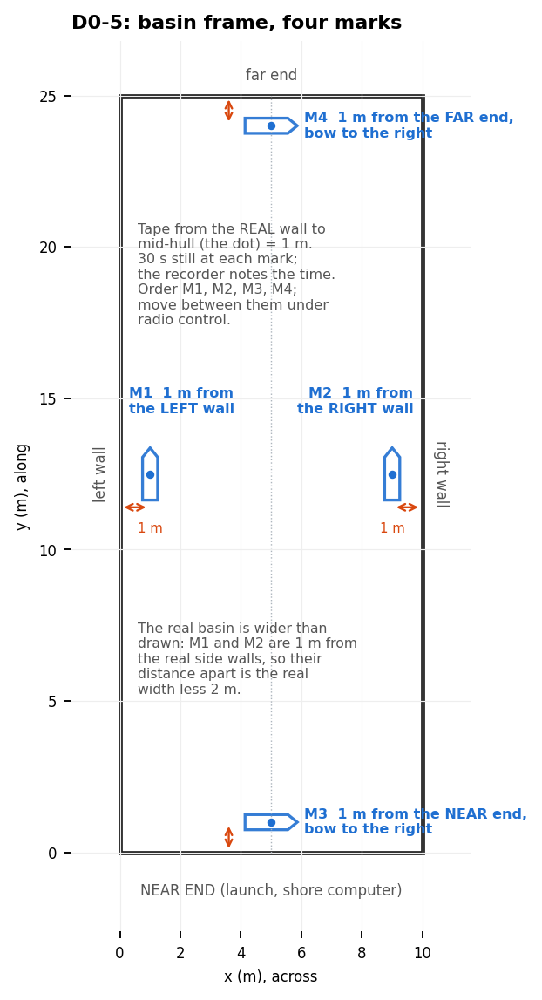
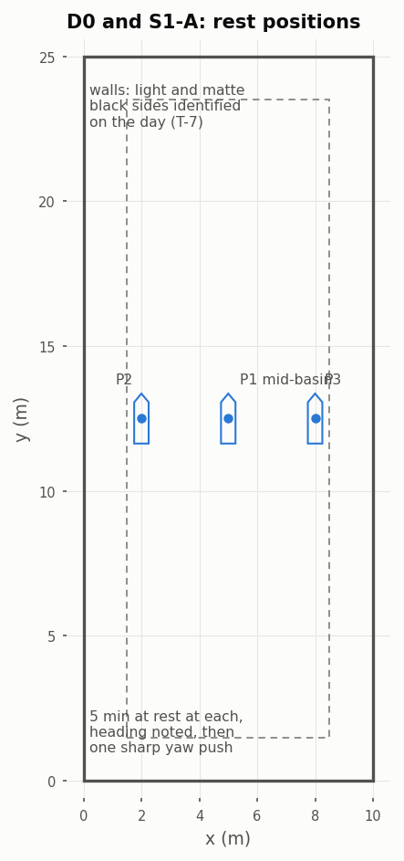
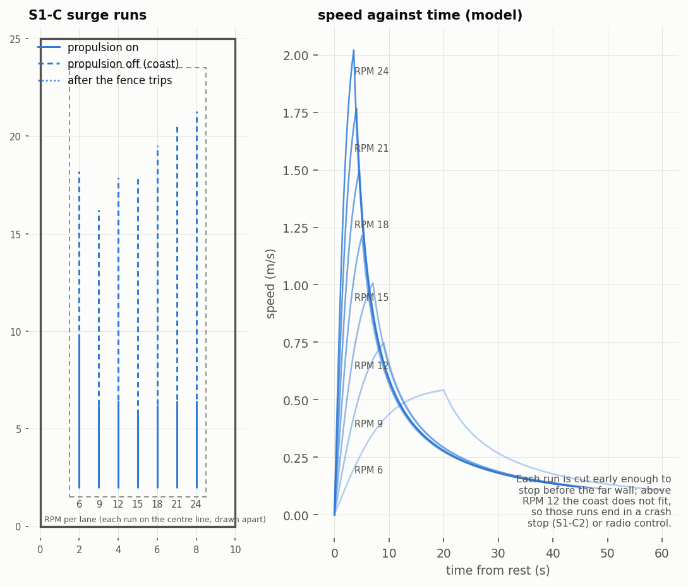
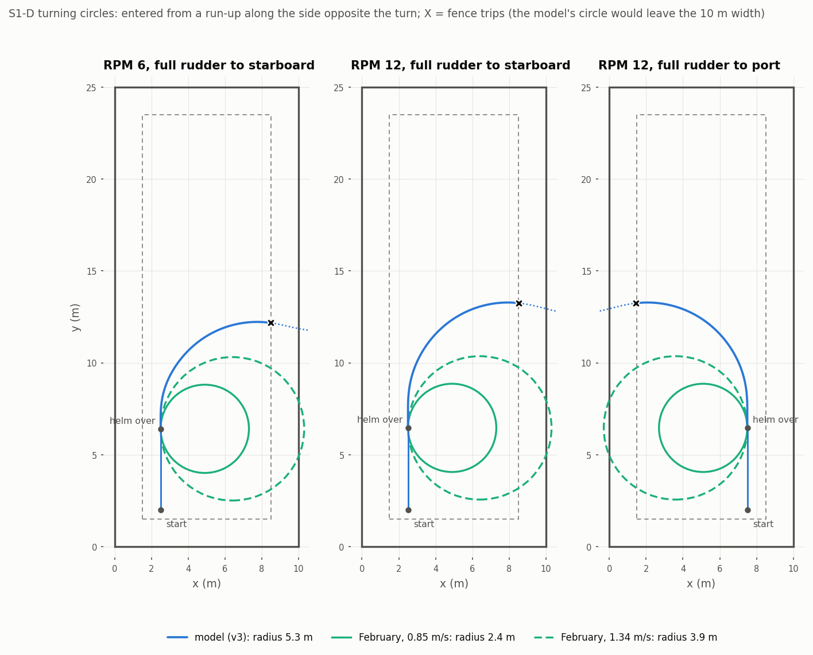
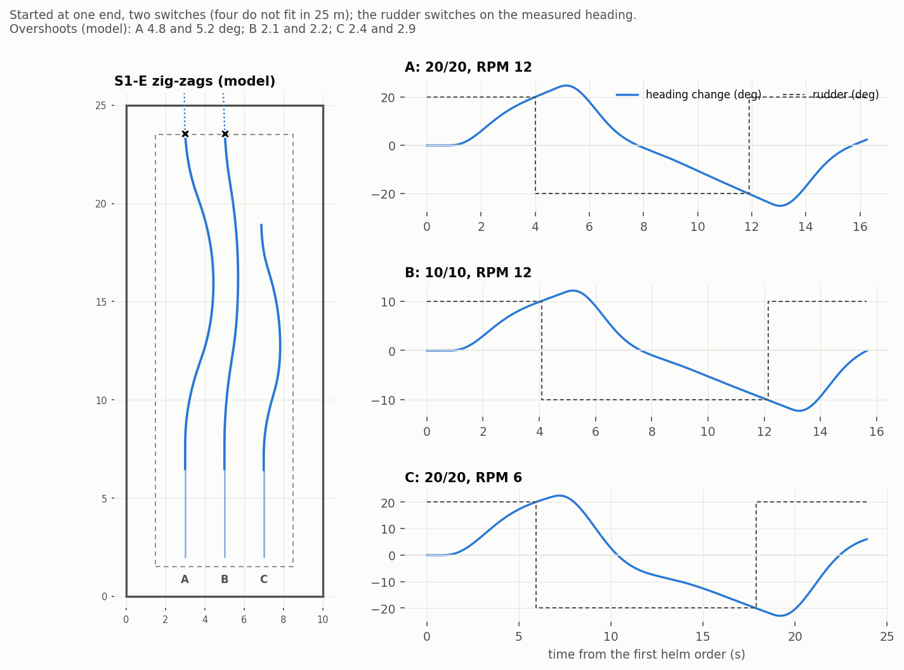

# D0 operations, Thursday 2026-11-26 (data collection, then S1a if D0 passes)

Step-by-step procedure for the basin session of 2026-11-26 on the Ubuntu lab laptop (host
SIMDELL), the shore computer. Sources:
- `static_dynamic_obstacles/planning/FIELD_SESSIONS_PLAN.md` sections 2 (roles, equipment,
  records, checks, abort rules), 4 (D0) and 5.1 (S1a);
- `static_dynamic_obstacles/planning/FIELD_CALIBRATION_PLAN.md` (items and thresholds);
- `static_dynamic_obstacles/results/field_sessions/manoeuvre_predictions.txt` (model predictions);
- the route figures in `static_dynamic_obstacles/planning/field_sessions_figures/`.

The scripts are described in full in `FIELD_SCRIPTS_GUIDE.md`. Every command here that needs no
vessel was run on the laptop on 2026-11-25 (Python 3.10.11, repository at b87cc9bed); the quoted
output is from those runs. Steps that need the vessel are marked **on the day**.

Contents:
1. Before leaving
2. Roles
3. At the basin: laptop set-up
4. Session start checks
5. D0-1 to D0-5
6. The S1a gate
7. S1a (about 90 min)
8. Abort rules
9. End of session
10. After the session
11. Run sheet

## 1. Before leaving

- [ ] Bluefin with the IMU fitted and secured.
- [ ] At least two charged battery sets for the Bluefin; the radio-control transmitter charged,
      with its batteries.
- [ ] The vessel-control laptop charged, its vessel program working.
- [ ] The Ubuntu laptop charged, with its charger. Python and the tools were checked on
      2026-11-25: both self-tests passed and the B-8 bench passed.
- [ ] Tape measure, tape or chalk for the marks (three rest positions; four points 1 m from the
      walls), a protractor for the rudder post if available, a side camera or phone.
- [ ] The run sheet (section 11), printed or on a second device.
- [ ] The risk assessment with the abort rules of section 8.

## 2. Roles (FIELD_SESSIONS_PLAN.md section 2.1)

| Role | Task |
| --- | --- |
| Operator | the Ubuntu laptop: logger and manoeuvre sender, run identifiers, Ctrl+C |
| Safety | the radio-control transmitter; takes over on any stop call; recovers the vessel. Never also the operator during a scripted run |
| Recorder | run sheet, times, battery voltage, video, deviations |

One person may hold two roles in D0. During any run in which `udp_manoeuvre.py` sends commands,
the operator and safety roles are held by different people.

## 3. At the basin: laptop set-up

1. **Network.** Join the network used in July (P-11), not home Wi-Fi. Check the laptop's
   address:

   ```bash
   ip -brief addr
   ```

   The Wi-Fi line (`wlp2s0`) must show an address on the vessel-control laptop's network. At home
   on 2026-11-25 it showed `192.168.0.213/24`, the home network, which is wrong for the basin.
2. **Vessel-control laptop's IP.** Read it on that laptop (10.201.205.110 in July) and write it on
   the run sheet. Below it is `<IP>`. Check that it answers (**on the day**):

   ```bash
   ping -c 3 <IP>
   ```

   A ping that fails does not settle it (the other laptop may drop pings); the logger's handshake
   in D0-1 does.
3. **Firewall stays off; port 5000 free.**

   ```bash
   grep ENABLED /etc/ufw/ufw.conf
   ss -ulpn | grep -E ':5000\b' || echo "UDP 5000 free"
   ```

   Expected (as on 2026-11-25):

   ```
   ENABLED=no
   UDP 5000 free
   ```

4. **Python and the working folder.** Python 3.10.11 is the command `python`. On this laptop
   `python3` is Ubuntu's own 3.12; the tools also run on it, but the project uses `python`.

   ```bash
   cd ~/asv-path-replanning/asv-lidar/field_deployment
   python --version
   git log -1 --oneline
   mkdir -p 2026-11-26
   ```

   Expected: `Python 3.10.11`. Write the commit (b87cc9bed or later) on the run sheet. Do not run
   `git pull` at the basin.
5. **Self-test, once more:**

   ```bash
   python udp_raw_logger.py --selftest
   ```

   Expected: `[SELFTEST] PASSED: handshake, 14 datagrams logged byte for byte ...`.

All logs go in `2026-11-26/`, one file per run, named by the run identifier (D0-1 ... D0-5;
S1a-CHK-01, S1a-A-01, ...). An existing name is never overwritten (`_2` is added). Only one
program receives at a time: stop the logger (Ctrl+C) before the manoeuvre sender starts, and the
other way round.

## 4. Session start checks (FIELD_SESSIONS_PLAN.md section 2.4)

D0-1 and D0-2 are the link check and the clock and IMU check of section 2.4; they are not
repeated before them. The third check:

- **Radio-control stop (on the day):** with the vessel moving slowly under radio control, the
  safety person stops it once by the override or kill (P-12). Note it on the run sheet. The E key
  belongs to the bridge, which is not used today.

## 5. D0-1 to D0-5 (on the day)

Before each experiment, the vessel is at its mark, the operator states the run identifier, and the
recorder notes the start time on a stopwatch started with the logger. After each, run `--check` on
its log (section 5.7).

| Test | Time | Where | What is done | Why |
| --- | --- | --- | --- | --- |
| D0-1 Link | 2 min | S, at rest | nothing: record | the laptop and the vessel talk over UDP; which lines arrive, how often |
| D0-2 Rest and push | 2 min | S, at rest | one sharp push at the stern at 1:00 | IMU at rest (bias, noise); the push times the IMU clock against the pose clock |
| D0-3 Modes | 1 min per mode | S, at rest | change the vessel's telemetry mode between runs | the fastest stream rate and the finest pose the vessel can send |
| D0-4 Manual driving | about 15 min | from S | straights and turns by radio control (figure 3) | the IMU against the pose while moving: data for the IMU decoder |
| D0-5 Basin frame | about 5 min | four marks M1-M4 | 30 s still at each (figure 4) | where the walls are in the vessel's coordinates: the fence for S1a |

### 5.0 Where the vessel is: the frame and the start mark S



*Figure 1. The basin frame, the start mark S and the S1a fence.*

- **Frame** (as in the plan's figures): the basin seen from above, with the near end at the
  bottom. The near end is the launch end, where the shore computer stands.
  - x runs across from the left wall, y along from the near end; left and right are as seen from
    the near end, looking up the basin.
  - The planned box is 10 m x 25 m. The real basin is wider (the February logs crossed 10.9 m),
    so the box sits centred across it and x = 5 m is the real basin's centreline.
  - The dashed line is the S1a fence, 1.5 m inside the box.
- **Start mark S = (5, 2):** on the centreline, 2 m from the near-end wall, measured with the tape
  from the wall to mid-hull. Mid-hull is the pose reference point, 0.86 m behind the bow. The bow
  points up the basin (+y). Mark the spot on the edge (tape or chalk on the wall's top) so every
  run starts from the same place.
- **Why 2 m and not 1 m:** the hull is 1.725 m long with the reference point at mid-hull, so at
  y = 1 m the stern would be 0.14 m from the wall; at y = 2 m it is 1.1 m clear. (5, 2) is also
  where the own ship starts in the simulated field cases.
- **Start the vessel program with the vessel at S, bow up the basin.** In the February logs the
  pose origin was at the bottom right in some runs and the bottom middle in others, which
  suggests the localisation sets its origin where it is started. If so, starting at S makes the
  pose frame the basin frame shifted by (5, 2). D0-5 confirms or corrects this; it is not known
  until then.
- **"At rest"** means floating free with nobody touching it. If the vessel drifts, a tether may
  hold it near the mark, but any tether hangs slack while recording.

### 5.1 D0-1 Link (2 min)



*Figure 2. D0-1 to D0-3 at S; where and when to push in D0-2.*

```bash
python udp_raw_logger.py --server-ip <IP> --out 2026-11-26/D0-1.log --duration-s 120
```

- **Purpose:**
  - prove that the shore laptop and the vessel-control laptop talk over UDP (`START` out, `hey`
    and telemetry back);
  - see which line types the vessel now sends and how often, in particular the new IMU lines.
- **Where:** at S, at rest, bow up the basin.
- **Procedure:** start the logger; record 2 min (it stops by itself). Nobody touches the vessel.
- **Expected:**
  - `[RAW] first datagram after` a few seconds; `hey` lines in the table, and `vessel answered
    hey` in the meta file;
  - LiDAR lines of 720 integers and pose lines of three values, at 2 Hz (the July mode) or 10 Hz
    (the February mode);
  - IMU lines as a new kind, printed in full when they first arrive. About 100 per second if the
    IMU streams raw at 100 Hz.
- **If nothing arrives within 10 s:**
  - the logger prints that the handshake was sent again;
  - check the IP, the network (section 3), and that the vessel program runs and listens on 5050;
  - Ctrl+C, correct, start again (the next file is `D0-1_2.log`; keep both).
- **If the IMU lines show `decoder error` or `taken as a scan`:** expected for a new bracketed
  format, and recorded as such. The logger keeps everything; only the bridges would need the
  decoder change (B-3).

### 5.2 D0-2 At rest, with one push (2 min)

```bash
python udp_raw_logger.py --server-ip <IP> --out 2026-11-26/D0-2.log --duration-s 120
```

- **Purpose:**
  - **IMU at rest:** what the gyro reads when nothing rotates (its bias) and how much it
    fluctuates (its noise). The IMU decoder (B-3) subtracts the bias.
  - **Pose at rest:** whether the localisation stays steady when nothing moves.
  - **Clock offset (P-5):** one sharp rotation appears in both the IMU's yaw rate and the pose
    heading. The time between the two is how far apart their clocks are, which the model fit must
    correct, or it reads as actuator lag.
- **Where:** at S, at rest, bow up the basin (figure 2).
- **Procedure:**
  - 0:00-1:00: hands off.
  - **At 1:00: one push.** From the near-end wall, push the **stern sideways**, sharply (about
    0.3 s), by hand or with a pole, hard enough to turn the hull 10-20 deg. The bow swings the
    other way: the hull rotates about its middle, which is what the gyro and the pose heading
    both see. The recorder notes the time of the push to the second.
  - 1:00-2:00: hands off.
- **Not at mid-side:** a push at the middle of the side makes the hull drift sideways with almost
  no rotation. The gyro hardly sees it and the heading does not change. A slow or long push
  smears the time of the event; it must be one short, sharp shove.
- **Why 2 min is enough** (decision of 2026-11-26; the plan had 5 min at rest):
  - 1 min at rest gives about 6,000 IMU samples at 100 Hz, enough for the gyro bias and noise;
  - the push needs only a quiet stretch on either side;
  - localisation drift over minutes (T-8) is measured later, in S1-A, with 5 min at each of three
    positions.
- **Expected:**
  - the gyro steady around a small constant (its bias) before and after the push;
  - the pose steady within its 0.1 m and 0.1 deg resolution, with no jumps;
  - at 1:00, a spike in the IMU yaw rate and a 10-20 deg step in the pose heading. Both are read
    after the session, once the IMU line format is known.

### 5.3 D0-3 Telemetry modes (1 min per mode; only if the vessel program has a rate setting)

```bash
python udp_raw_logger.py --server-ip <IP> --out 2026-11-26/D0-3a.log --duration-s 60
```

- **Purpose:** the vessel program has streamed at 2 Hz (July) and 10 Hz (February). This finds
  the fastest rate it sustains now, the pose resolution in each mode, and whether the IMU's rate
  depends on the mode. That decides P-1 (telemetry at 10 Hz or more, pose finer than 0.1 m) for
  S1b.
- **Where:** at S, at rest.
- **Procedure:** one log per mode (`D0-3a`, `D0-3b`, ...). The mode is changed on the
  vessel-control laptop between logs; note each mode's setting on the run sheet.
- **Expected:** the rate per line kind in the status line and in `--check`, and the number of
  decimals in the pose lines.
- If there is no rate setting, skip D0-3 and note "no rate setting".

### 5.4 D0-4 Manual driving (about 15 min)



*Figure 3. D0-4: the straight runs (a) and the turns (b), in order 1, 2, 3a, 3b, 4.*

```bash
python udp_raw_logger.py --server-ip <IP> --out 2026-11-26/D0-4.log
```

- **Purpose:**
  - the IMU while moving, against the pose: does the IMU yaw rate follow the turn rate from the
    pose (sign and scale), and does the forward acceleration match the change in speed? This is
    the data for writing the IMU decoder and the ego-motion estimate (B-3);
  - first numbers on the steady speed per throttle setting, on how the vessel slows with the
    throttle cut, and on the full-stick turning circle.
- **Where:** from S. The safety person drives by radio control; the logger runs throughout; Ctrl+C
  at the end.
- **Procedure** (figure 3; the recorder notes the start time of each leg and the throttle used):
  1. **Slow straight (throttle A, about walking pace):** from S up the centreline. Cut the
     throttle at mid-basin (y = 12) and let the vessel coast. The model coasts about 11 m before
     it is nearly stopped; steer away from the far wall if needed.
  2. **Turn round slowly** at the far end, by any means.
  3. **Faster straight (throttle B):** down the basin at x = 6.5. Cut the throttle at y = 16 and
     coast (about 13 m in the model).
  4. **3a, full stick right:** run up along x = 2.6 (2.4 m left of the centreline). At y = 7, full
     stick right for one full turn, then centre the stick. Throttle no higher than about 0.85 m/s,
     where February's circle was 2.4 m in radius (4.8 m across), which fits inside the fence.
  5. **3b, full stick left:** run up along x = 7.4. At y = 14, full stick left for one full turn.
  6. **4, gentle S-bends:** at slow throttle and half stick, alternating sides, from y = 17. Cut
     the throttle by y = 21.

  The circles start on the side opposite the turn so that they open across the basin (the plan's
  route for full-rudder circles). Any leg can be cut short if the vessel nears a wall.
- **Expected:**
  - the IMU yaw rate rising and falling with the turns, with the opposite sign for 3a and 3b;
  - the surge acceleration matching the change of the pose-derived speed;
  - `RC` lines (about 1 Hz) carrying the stick positions.

  February reference (radio control, `data/test_4.log`): full-stick circles of radius 2.4 m at
  0.85 m/s and 3.9 m at 1.34 m/s, both at about 19 deg/s; straight runs up to 1.62 m/s.
- If time is left at the end of the booking and S1a does not run, repeat D0-4 with more variety
  (it serves the IMU decoder, B-3).

### 5.5 D0-5 Basin frame (about 5 min)



*Figure 4. D0-5: the four marks, each 1 m from a real wall.*

```bash
python udp_raw_logger.py --server-ip <IP> --out 2026-11-26/D0-5.log
```

- **Purpose:** the vessel reports its position in its own coordinates (the pose frame), whose
  origin and axes are not known (the February logs put the origin in different places). D0-5
  places the vessel at four known points near the walls, so the walls can be located in the pose
  frame. That gives:
  - the S1a fence (below);
  - the pose origin and axis directions (whether starting at S puts the origin at S);
  - later, the bridge's map registration.
- **Where:** four marks, each 1 m from a REAL wall, taped from the wall to mid-hull (figure 4):
  - M1: 1 m from the left wall, at mid-length, bow up the basin;
  - M2: 1 m from the right wall, at mid-length, bow up the basin;
  - M3: 1 m from the near end, on the centreline, the hull parallel to the wall (bow to the
    right), so neither end of the hull is near the wall;
  - M4: 1 m from the far end, on the centreline, likewise.
- **Procedure:** start the logger. Drive to M1 under radio control and hold the vessel still
  there for about 30 s; then M2, M3 and M4 in turn. The recorder notes the time and the mark at
  each. Ctrl+C at the end.
- **Expected:**
  - four clusters of nearly constant pose, one per mark;
  - M1 and M2 differ mainly in one pose axis, the real width less 2 m apart; M3 and M4 differ
    mainly in the other, the real length less 2 m apart. This gives the axis directions;
  - if the vessel program was started at S, the pose near (0, 0) at S, and M3 about 1 m from
    S's pose along the length axis.
### 5.6 The S1a fence from D0-5

- **Fence for S1a: the planned 10 m x 25 m box, not the whole basin.** Every manoeuvre is planned
  in a basin 10 m wide and 25 m long, kept as the safe area although the real basin is wider (the
  February logs crossed 10.9 m). `udp_manoeuvre.py` enforces that box with `--fence=` and its
  1.5 m margin (`--fence-margin-m`, default 1.5), as set out in FIELD_SESSIONS_PLAN.md
  (decision of 2026-11-24).
  - D0-5 gives the real basin's edges: the extremes of the pose over the log, each pushed out by
    1 m to the wall (pose frame: for a raw line `[ts]A,B,C`, x = B and y = -A).
  - The command then places the 10 m x 25 m box inside those edges. The shorter measured side is
    taken as the width.
  - Along each side, the box is centred on the measured basin, moved by `OFF_W` (across the
    width) or `OFF_L` (along the length), in metres in the pose frame, 0 by default.
  - Where the measured basin is no wider than 10 m (or no longer than 25 m), the measured edges
    are the fence on that side.
  - **The placement is decided on the day:** centred unless the operators choose an offset (for
    example, to keep the box clear of a ladder or the black wall). Then set `OFF_W` or `OFF_L` at
    the start of the command and run it again.

  ```bash
  OFF_W=0 OFF_L=0 python -c 'import os, sys, udp_manoeuvre as m; p = [(float(g["x"]), -float(g["y"])) for g in (m.RE_POSE.match(l.strip()) for l in open(sys.argv[1], errors="ignore")) if g]; lo = [min(c) - 1 for c in zip(*p)]; hi = [max(c) + 1 for c in zip(*p)]; ext = [b - a for a, b in zip(lo, hi)]; w = 0 if ext[0] <= ext[1] else 1; size = {w: 10.0, 1 - w: 25.0}; off = {w: float(os.environ.get("OFF_W", 0)), 1 - w: float(os.environ.get("OFF_L", 0))}; box = [(lo[i], hi[i]) if ext[i] <= size[i] else ((lo[i] + hi[i]) / 2 + off[i] - size[i] / 2, (lo[i] + hi[i]) / 2 + off[i] + size[i] / 2) for i in (0, 1)]; print("pose lines %d; measured basin x %.1f to %.1f (%.1f m), y %.1f to %.1f (%.1f m); width along %s" % (len(p), lo[0], hi[0], ext[0], lo[1], hi[1], ext[1], "xy"[w])); print("--fence=%.1f,%.1f,%.1f,%.1f" % (box[0][0], box[0][1], box[1][0], box[1][1])); [print("WARNING: the box leaves the measured basin along %s" % "xy"[i]) for i in (0, 1) if box[i][0] < lo[i] - 1e-9 or box[i][1] > hi[i] + 1e-9]' 2026-11-26/D0-5.log
  ```

  Output on 2026-11-25:
  - On a synthetic log of a 12 m x 26 m basin, with marks 1 m from each wall:

    ```
    pose lines 15; measured basin x 0.0 to 12.0 (12.0 m), y 0.0 to 26.0 (26.0 m); width along x
    --fence=1.0,11.0,0.5,25.5
    ```

    The same log with `OFF_W=2` gives `--fence=3.0,13.0,0.5,25.5` and
    `WARNING: the box leaves the measured basin along x`. An offset that pushes the box outside
    the basin is wrong; reduce it.
  - On the July rehearsal log (`2026-07-03/1.log`, a stretch of path, not a basin frame), the
    measured area is narrower than the box on both sides, so the measured edges come back:

    ```
    pose lines 31; measured basin x -0.9 to 2.3 (3.2 m), y -1.0 to 15.6 (16.6 m); width along x
    --fence=-0.9,2.3,-1.0,15.6
    ```

  - Check the measured basin against the tape: the measured width and length should match the
    real basin to within about half a metre. Any pose taken while moving between marks lies
    inside the four, so it does not widen the measurement. A jump in the pose (a localisation
    glitch) would: if the measurement is clearly too large, read the pose at each noted time
    instead.
  - Write the `--fence=...` string and the offsets used on the run sheet. Below it is `<FENCE>`.
    The routes in section 7 (run-up along x = 2.5 m and x = 7.5 m of the 10 m width) are measured
    from the box's edge, not from the basin wall.

### 5.7 After each experiment

```bash
python udp_raw_logger.py --check 2026-11-26/D0-1.log
```

Output format (from the rehearsal log):

```
.../D0-mock.log: 61 lines
  line kind                             count   rate /s  decoder
  pose (3 values)                          31       2.0  read
  LiDAR scan (720)                         30       2.0  read
```

Note on the run sheet each line kind with its rate. The rates come from the vessel's time stamps,
which answers the IMU rate question directly.

## 6. The S1a gate (FIELD_SESSIONS_PLAN.md section 4.5)

S1a starts only if all four hold:

| Condition | How to check | Result |
| --- | --- | --- |
| The link ran for 5 min with no gap longer than 1 s | the largest gap in D0-4 (about 15 min), command below | |
| IMU lines are present and carry the vessel's time stamps | `--check` on D0-1: an IMU kind with a rate (a rate needs the vessel's stamps) | |
| The basin frame is read (D0-5) | a `<FENCE>` string written down and checked against the marks | |
| At least 90 min of basin time and a fresh battery set remain | the clock; the battery sets | |

Largest gap between datagrams in a log:

```bash
python -c "import csv, sys; t = [float(r['t_since_start_s']) for r in csv.DictReader(open(sys.argv[1] + '.arrivals.csv'))]; print('datagrams %d, span %.1f s, largest gap %.2f s' % (len(t), t[-1] - t[0], max(b - a for a, b in zip(t, t[1:]))))" 2026-11-26/D0-4.log
```

Output on the rehearsal log: `datagrams 61, span 15.1 s, largest gap 0.50 s`. A gap of 0.50 s is
the 2 Hz stream itself; the gate needs the largest gap at or below 1 s.

If any condition fails, S1a does not run. Repeat D0-4 with more variety for the rest of the
booking, and note which condition failed.

## 7. S1a (about 90 min; on the day)

All S1a commands use the same start. Below it is written `...`:

```bash
python udp_manoeuvre.py --server-ip <IP> --fence=<FENCE> --out 2026-11-26/<run id>.log
```

How every run goes:
1. The vessel is at its start mark; the safety person is ready on the transmitter.
2. Start the command. Wait for `[MAN] telemetry flowing`.
3. If the fence line says `OUTSIDE`, do not press Enter: move the vessel or correct the fence.
4. Press Enter to start.
5. Ctrl+C stops at once (three zero commands).

Stops:
- A fence trip cuts propulsion and prints `TAKE OVER BY RADIO CONTROL`; the safety person takes
  over. Crash stops (astern) are not run today: the ESC reversal (P-8) is untested, so no command
  uses `--allow-astern`.
- If the vessel-control laptop does not take `$CMD` at all, the blocks run under radio control
  instead (FIELD_SESSIONS_PLAN.md section 5.3, RC-1 to RC-3), logged with `udp_raw_logger.py`.

### 7.1 First check on the vessel (rudder sign)

- **Purpose:** before any scripted manoeuvre, prove that the vessel obeys `$CMD` from the laptop
  (hold) and that a positive rudder turns it to starboard (turn). If the sign were wrong, every
  later command would steer the wrong way.
- **Where:** both runs start at S, bow up the basin. The hold ends about 3-4 m up the centreline;
  bring the vessel back to S by radio control before the turn. The turn ends about 10 m up the
  basin.

```bash
... --out 2026-11-26/S1a-CHK-01.log hold --rpm 6 --duration-s 10
... --out 2026-11-26/S1a-CHK-02.log turn --rpm 6 --rudder 50 --duration-s 5
```

- **Hold:** S2 25 sent (`$CMD,0.00,25.00`); the vessel moves ahead slowly. Model: steady speed
  0.56 m/s at RPM 6, 90 % of it after 14 s and 4.4 m, so after 10 s about 0.5 m/s and 3-4 m run.
  - If the vessel does not move: the vessel-control laptop is not taking `$CMD`. Check its program,
    then go to the radio-control back-up.
  - If the vessel goes astern: stop (Ctrl+C) and report. Do not continue.
- **Turn:**
  - a 14 s straight run-up at RPM 6 (the default `--runup-s`), then rudder +50 % for 5 s, then
    straight for 3 s: about 22 s and 10 m in all, so start at one end of the basin;
  - the vessel receives `$CMD,-50.00,25.00` (rudder sign -1);
  - model: about 2.5 deg/s at steady state (helm 50 %, RPM 6). The February turns were about
    twice as fast;
  - it reports `turning side=starboard (heading increasing), as_expected=True`. If it reports
    `port ... as_expected=False`, the sign is reversed: repeat as `S1a-CHK-03` with
    `--rudder-sign 1` added before the subcommand, and use that setting for every later S1a
    command.

### 7.2 S1-A Sensing baseline (25 min)



*Plan figure: S1-A rest positions P1, P2, P3.*

- **Purpose:** the sensors with the vessel still, at three places:
  - how far the localisation drifts over 5 min (T-8);
  - how noisy the LiDAR ranges are, and whether the matte black wall returns the beam (T-7);
  - whether the reported position is mid-hull or the LiDAR, 0.86 m ahead (O-9), by comparing the
    pose with the taped marks.
- **Where** (plan figure above): P1 mid-basin (5, 12.5), P2 near one side wall (2, 12.5), P3 near
  the other (8, 12.5), each taped to mid-hull, bow up the basin. Note which side wall is the
  black one.
- **Why 5 min here** (and not 2 as in D0-2): drift is the measurement, and it needs minutes to
  show. If time is short, 3 min each still gives a drift rate, with less precision.

At rest, so the logger is used (no command needed):

```bash
python udp_raw_logger.py --server-ip <IP> --out 2026-11-26/S1a-A-01.log --duration-s 330
```

- Three runs, `S1a-A-01` to `S1a-A-03`, at P1, P2 and P3.
- At each: heading noted, 5 min untouched, then one push at about 5:00 (time noted), then 30 s.
  The push is as in D0-2: the stern, sideways, sharply (figure 2).
- **Expected:**
  - gyro bias;
  - localisation drift at rest (T-8);
  - LiDAR range noise;
  - the return rate against the black wall (T-7);
  - the pose reference point (O-9), from the marks' measured positions.

### 7.3 Coast-downs (20 min)



*Plan figure: straight runs and coast-downs.*

- **Purpose:** how quickly the vessel slows with no thrust. That is the water resistance (drag)
  in the vessel model, which sets how far it carries on when the propulsion stops.
- **Where:** from S, bow up the basin, along the centreline (plan figure above).

```bash
... --out 2026-11-26/S1a-C-01.log coast --rpm 12 --runup-s 10
... --out 2026-11-26/S1a-C-04.log coast --rpm 9 --runup-s 12
```

- Three runs each (`S1a-C-01` to `-03` at RPM 12, `-04` to `-06` at RPM 9), each started at S;
  bring the vessel back to S by radio control between runs.
- The coast lasts 20 s (`--coast-s` default).
- **Expected (model):**
  - from RPM 12 (1.12 m/s): half speed after 4.7 s; 0.1 m/s after 48 s and 12.8 m;
  - from RPM 9 (0.84 m/s): half speed after 6.3 s; 0.1 m/s after 47 s and 11.3 m.
- The first 5-10 s carry most of the drag information. The far wall cuts the tail: a fence trip
  during the coast only adds the take-over call.

### 7.4 Full-rudder turning circles (30 min)



*Plan figure: full-rudder circles, model and February measurement, with the fence.*

- **Purpose:** the steady turn rate and radius at full rudder, at two speeds and both sides. These
  set the steering part of the vessel model, which at present predicts a 5.3 m radius, against
  February's measured 2.4-3.9 m.
- **Where:** the run-up starts at the near end on the side opposite the turn (plan figure above):
  starboard turns (`--rudder 100`) from (2.5, 2), port turns (`--rudder -100`) from (7.5, 2), bow
  up the basin.

```bash
... --out 2026-11-26/S1a-D-01.log turn --rpm 6 --rudder 100 --heading-change 720
... --out 2026-11-26/S1a-D-03.log turn --rpm 6 --rudder -100 --heading-change 720
... --out 2026-11-26/S1a-D-05.log turn --rpm 12 --rudder 100 --heading-change 720
... --out 2026-11-26/S1a-D-07.log turn --rpm 12 --rudder -100 --heading-change 720
```

- Two runs each (`S1a-D-01` to `-08`).
- The run-up along the side opposite the turn makes the circle open across the basin, not into
  the nearer wall.
- At RPM 6, add `--max-s 240` before the subcommand: two full turns take about 140 s in the model,
  plus the 14 s run-up, close to the 180 s default.
- **Expected:**

  | Setting | Model (current simulator plant) | February 2026, radio control |
  | --- | --- | --- |
  | RPM 6, helm 100 % | 5.1 deg/s, radius 5.3 m, 0.46 m/s in the turn, 360 deg in 69 s, tactical diameter 10.5 m | - |
  | RPM 12, helm 100 % | 10.0 deg/s, radius 5.3 m, 0.93 m/s in the turn (0.83 of straight), 360 deg in 36 s, tactical diameter 10.7 m | radius 2.4 m at 0.85 m/s and 3.9 m at 1.34 m/s, both at about 19 deg/s |

- The measured circles are expected near February's, not the model's. A 2.4 m circle (4.8 m
  across) fits the 10 m width; the 3.9 m one (8.6 m across in February) and the model's would
  reach the fence and end as arcs (a fence trip: take over by radio control).
- RPM 18 runs only if the RPM 12 circle measured no more than 7 m across (the width inside the
  fence).

### 7.5 First zig-zag (15 min)



*Plan figure: zig-zags.*

- **Purpose:** how quickly the hull answers a rudder change and how far it overshoots before
  turning back. This is the dynamic part of the steering model, which the steady circles do not
  show.
- **Where:** from S, bow up the basin (plan figure above).

```bash
... --out 2026-11-26/S1a-E-01.log zigzag --rpm 12 --delta 20 --psi 20 --switches 2
... --out 2026-11-26/S1a-E-02.log zigzag --rpm 12 --delta -20 --psi 20 --switches 2
```

- Both initial sides: `--delta 20` starts to starboard, `--delta -20` to port. A dry run on 2026-11-25 confirmed that `--delta -20` gives
  `first helm -50` (20 deg of the 40 deg maximum) and sends `$CMD,50.00,50.00`.
- Two switches give the first and second overshoots; four do not fit in 25 m.
- **Expected (model, 20/20 at RPM 12):**
  - overshoots 4.8 and 5.2 deg;
  - period 15.9 s;
  - lateral excursion 1.5 m;
  - 13.8 m run up to the second overshoot (with the 7 s run-up, about 20 of the 25 m).

  With turns as tight as February's, larger overshoots are likely. The overshoots and switch times
  are in the run's `.meta.json` events.

## 8. Abort rules (FIELD_SESSIONS_PLAN.md section 2.5)

Stop the run (Ctrl+C on the laptop, and the radio-control override) when:
- telemetry stops for more than 1.5 s (the manoeuvre sender aborts by itself: `abort: telemetry
  lost for 1.5 s`);
- the vessel will strike a wall and no avoiding action has begun;
- the vessel leaves the navigable area by more than 0.5 m;
- the safety person calls a stop, or anything else is unsafe.

After any stop: the vessel recovered and at rest, the run marked on the run sheet with the reason,
its log kept.

## 9. End of session

1. **Clock and IMU check, repeated** (section 2.4 item 4), so drift over the session is measured:

   ```bash
   python udp_raw_logger.py --server-ip <IP> --out 2026-11-26/END-1.log --duration-s 120
   ```

   As D0-2, at S: 1 min at rest, one push at the stern at 1:00 (time noted), 1 min at rest.
2. Vessel out, batteries off, the end time noted.

## 10. After the session

1. `--check` on every log:

   ```bash
   for f in 2026-11-26/*.log; do python udp_raw_logger.py --check "$f"; done
   ```

   Manoeuvre logs also hold `#CMD` and `#MAN` lines, which count as their own kinds.
2. Keep every log exactly as recorded, with its `.arrivals.csv`, `.meta.json` and, for the
   manoeuvre sender, `.commands.csv`. Nothing is edited or deleted. A run that went wrong is kept
   and marked invalid on the run sheet, with the reason.
3. Copy the folder `2026-11-26/` to a second place (USB stick or the personal laptop) before
   leaving the basin.
4. Report back to the development laptop the same day:
   - the list of logs with their line kinds and rates;
   - the IMU line format (one example line);
   - the telemetry mode;
   - the largest gap;
   - the `<FENCE>` string and the pose frame's origin and axes;
   - the rudder-sign result;
   - which S1a blocks ran;
   - any deviation.

   Committing the logs (to `field_deployment/2026-11-26/`) waits for a decision.
5. Next on the bench: the IMU decoder (B-3), the fit script's reader (P-6), and the decisions on
   P-1 and O-1.

## 11. Run sheet

Session D0 and S1a, 2026-11-26. Vessel-control IP: ________ Network: ________ Commit: ________
Vessel software version: ________ Telemetry mode (rate, resolution): ________
Basin state (water level, wind or draught from the doors): ________
Measured basin (D0-5): ________ Fence (`--fence=`, 10 m x 25 m box): ________
Offsets OFF_W / OFF_L: ____ / ____ Rudder sign: ________

| Run identifier | Start | End | Settings (helm, RPM or throttle, mark) | Battery V | Deviation | Valid? (reason if not) |
| --- | --- | --- | --- | --- | --- | --- |
| D0-1 | | | rest at S | | | |
| D0-2 | | | rest at S; push at ____ (about 1:00) | | | |
| D0-3a | | | mode: | | | |
| D0-3b | | | mode: | | | |
| D0-4 | | | RC: throttle settings ____ / ____ | | | |
| D0-5 | | | M1 ____ M2 ____ M3 ____ M4 ____ (times) | | | |
| S1a-CHK-01 | | | hold, RPM 6, 10 s | | | |
| S1a-CHK-02 | | | turn, RPM 6, helm 50 %, 5 s; side: | | | |
| S1a-A-01 | | | rest at P1 (5, 12.5); push at ____ | | | |
| S1a-A-02 | | | rest at P2 (2, 12.5), ____ wall; push at ____ | | | |
| S1a-A-03 | | | rest at P3 (8, 12.5), ____ wall; push at ____ | | | |
| S1a-C-01 | | | coast, RPM 12 | | | |
| S1a-C-02 | | | coast, RPM 12 | | | |
| S1a-C-03 | | | coast, RPM 12 | | | |
| S1a-C-04 | | | coast, RPM 9 | | | |
| S1a-C-05 | | | coast, RPM 9 | | | |
| S1a-C-06 | | | coast, RPM 9 | | | |
| S1a-D-01 | | | turn, RPM 6, helm +100 % | | | |
| S1a-D-02 | | | turn, RPM 6, helm +100 % | | | |
| S1a-D-03 | | | turn, RPM 6, helm -100 % | | | |
| S1a-D-04 | | | turn, RPM 6, helm -100 % | | | |
| S1a-D-05 | | | turn, RPM 12, helm +100 % | | | |
| S1a-D-06 | | | turn, RPM 12, helm +100 % | | | |
| S1a-D-07 | | | turn, RPM 12, helm -100 % | | | |
| S1a-D-08 | | | turn, RPM 12, helm -100 % | | | |
| S1a-E-01 | | | zig-zag 20/20, RPM 12, starboard first | | | |
| S1a-E-02 | | | zig-zag 20/20, RPM 12, port first | | | |
| END-1 | | | rest at S; push at ____ (about 1:00) | | | |

Block times (start and end): D0 ______ S1-A ______ coast ______ circles ______ zig-zag ______
