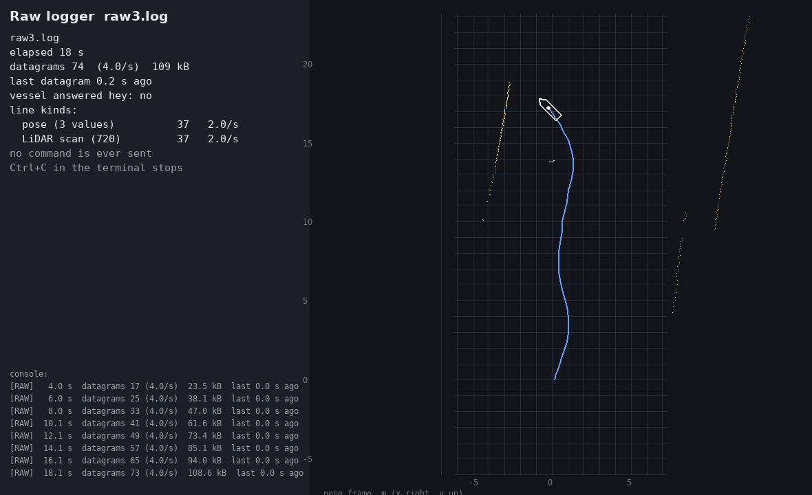
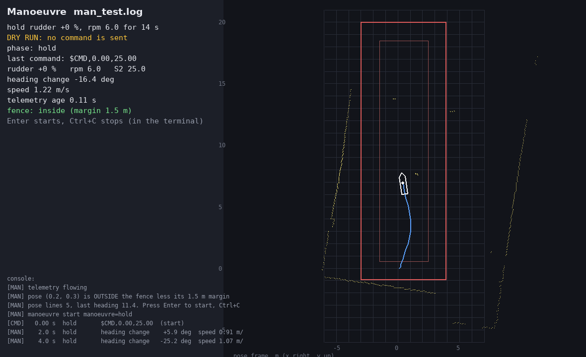

# Field scripts: how to use them (calibration and field trials)

Written 2026-11-25 on the Ubuntu lab laptop (host SIMDELL; Python 3.10.11 then, Python 3.12.3
since 2026-11-28; repository at b87cc9bed), the shore computer for every basin session. Every command below that needs no vessel
was run on that laptop before it was written down; the quoted output is from those runs (paths
shortened). Steps that need the vessel are marked **on the day**.

Each script's own `--help` and docstring remain the reference; this guide shows how the scripts
fit together. All commands run from `asv-lidar/field_deployment/` with `python`. The project's
single Python version is 3.12 since 2026-11-28 (3.10.11 before; the Windows laptops follow). On
the Ubuntu laptop `python` and `python3` are both Ubuntu's own 3.12.3, the interpreter ROS 2
Jazzy also uses; the pinned packages of `static_dynamic_obstacles/requirements.txt` are installed
for it in the user site (`python -m pip install --user --break-system-packages ...`), with no
venv.

Contents:
1. Overview: which script for which job
2. The link to the vessel (ports, handshake, command line)
3. `udp_raw_logger.py`: raw telemetry logger (D0, at-rest blocks)
4. `udp_manoeuvre.py`: scripted calibration manoeuvres
5. `udp_live_p3.py`: the Paper 3 bridge (live, shadow mode, no-send mode)
6. Mock vessel: testing the UDP connection without the vessel
7. Replaying and viewing saved logs
8. Bench tools
9. Older and helper scripts
10. Same as July, and what changed
11. Testing the UDP connection, in order
12. Quick reference

## 1. Overview: which script for which job

| Job | Script | Sends commands? | Needs |
| --- | --- | --- | --- |
| Record the raw telemetry (D0, at-rest blocks, any new line format) | `udp_raw_logger.py` | never | standard library; the window (on by default) also needs pygame and `telemetry_view.py` |
| Calibration manoeuvres with exact, timed commands (S1, S2-B) | `udp_manoeuvre.py` | yes (`--dry-run`: no) | standard library; the window (on by default) also needs pygame and `telemetry_view.py` |
| The deployed policy on the vessel (S2-C, trials) | `udp_live_p3.py` | yes (`--no-send`: no) | the pinned Python environment, the policy |
| A stand-in vessel replaying a log over UDP (bench) | `fake_vessel_replay.py` | - | standard library only |
| The bridge on saved logs, in process and over UDP (bench) | `p3_shadow_replay.py` | no | the pinned environment |
| Bridge against simulator, decision by decision (bench) | `p3_parity_replay.py` | no | the pinned environment |
| Run time per decision (bench) | `p3_timing.py` | no | the pinned environment |
| Replay a saved log in the live window, with the full trajectory at the end | `log_replay_view.py` | no | pygame, `telemetry_view.py` |
| Offline viewer of a raw log (July tools) | `log_viewer.py`, `rl_log_viewer.py` | no | pygame |

Only one program can receive at a time: the logger, the manoeuvre sender and the bridge all listen
on UDP 5000. Stop one (Ctrl+C) before starting the next.

## 2. The link to the vessel

- The shore computer binds `0.0.0.0:5000` and sends the handshake `START` to the vessel-control
  laptop at `<server-ip>:5050` (10.201.205.110 in July; noted again before every session).
- The vessel answers with `hey` lines, then streams telemetry to the address the `START` came
  from: LiDAR lines (`[HH:MM:SS.ffffff][r0, r1, ..., r719]`, 720 integers), pose lines
  (`[HH:MM:SS.ffffff]A,B,C`) and, depending on the vessel program, `HDG` and `RC` lines and, from
  2026-11-26, IMU lines in a format still to be seen (D0).
- Commands go back as `$CMD,<vessel rudder>,<S2>`, two decimals each, for example
  `$CMD,0.00,25.00`.
  - Vessel rudder = `--rudder-sign` x rudder, with `--rudder-sign` -1 by default: the vessel's
    rudder sign is opposite to the simulator's.
  - S2 = RPM / 24 x 100. RPM 6 (cruise) is S2 25, RPM 12 is S2 50, and S2 = -100 is full astern.
- **What the vessel sends and what it logs** (D0, 2026-11-26).

  | | Sent to the shore computer (UDP) | Vessel's own log (`RAW_LOG`, `datalogs/laser_*.log`) |
  | --- | --- | --- |
  | Lines | `hey`, pose, LiDAR | pose, LiDAR, `GYRO`, `ACCEL`, `QUAT`, `SRVO` |
  | Rate | 2 Hz each, exactly every 0.500 s | pose up to about 85/s (repeated in bursts), LiDAR 10/s, IMU and `SRVO` about 9.5/s each |
  | Stamps | the sender's own | the logger's own |

  - **The UDP stream is a 2 Hz sample of the same data:**
    - each received pose equals the vessel's current pose (99-100 % identical within +/-0.1 s),
      stamped about 2.4 ms later;
    - each received scan equals a logged scan from about 50 ms before;
    - no received line appears word for word in the vessel's log.
  - **Nothing was lost on the shore computer and nothing was trimmed:** the logger writes every
    datagram as received. The IMU never reached the shore because the vessel did not send it. The
    one real loss is 15-30 % of the LiDAR scans, whose 2.9 kB datagrams are split into two packets
    and dropped on Wi-Fi.
  - **Raw-format line:** `[HH:MM:SS.ffffff]<counter ms>,<KIND>,<values>`
    - `GYRO,x,y,z`: deg/s, z is yaw, counter-clockwise positive, 1/16 deg/s steps;
    - `ACCEL,x,y,z`: m/s^2, gravity removed, 0.01 steps;
    - `QUAT,x,y,z,w`: unit norm; its heading drifts, so it is not a heading reference;
    - `SRVO,s1,s2,f1,f2`: servo values and two flags.
  - **Reading the raw format:**
    - `log_parser.BluefinStreamDecoder.raw_format()` (since 2026-11-27) reads it: the latest IMU
      and servo values ride on each frame (`gyro_dps`, `accel_mps2`, `quat_xyzw`, `srvo`,
      `imu_t_sec`); poses are read in the `nov2026` layout; speeds come from poses 0.5 s apart.
    - The decoder's defaults are unchanged (July layout, consecutive-pose speeds, IMU lines
      skipped). On 2026-11-27 the defaults gave frames identical to the earlier decoder on 40
      logs (63,359 frames), and the July shadow replay through the bridge was identical in all
      19 logs (1,085 decisions).
    - `udp_raw_logger.py` names these lines `vessel GYRO`, `vessel ACCEL`, `vessel QUAT` and
      `vessel SRVO` in its table, marked `read`.
    - `log_replay_view.py` replays the vessel's logs.
- **Where the vessel's lines come from** (the vessel's ROS 2 Jazzy recording
  `rosbag2_2026_11_26-11_08_31`, 11:08:31-11:36:31, read with the `rosbags` library on
  2026-11-27):

  | Line | ROS 2 source | Units and frame | Rate in the bag | Rate in the vessel's log | Rate over UDP |
  | --- | --- | --- | --- | --- | --- |
  | pose `[ts]A,B,C` | `/map_odom` (`map -> base_link`) | A = x, B = y (m, map frame, x forward and y left at SLAM start), C = yaw (deg, counter-clockwise) | 86 Hz | up to about 85/s | 2 Hz |
  | LiDAR `[ts][r0..r719]` | `/scan` (`lidar_frame`, -179 to +180 deg, 720 beams) | ranges x 10 (dm), 0 for no return, same beam order | 10 Hz | 10/s | 2 Hz (less after Wi-Fi loss) |
  | `GYRO,x,y,z` | `/imu/data_raw` (`imu_frame`) | deg/s; z counter-clockwise | 100 Hz | about 9.5/s | not sent |

  - **Match quality:**
    - pose against `/map_odom`: median error 0.04 m and 0.0 deg over 7,210 samples;
    - scans against `/scan`: 400 of 400 identical;
    - gyro against `/imu/data_raw`: correlation 0.995.
  - **`/tf_static`:**
    - `base_link -> lidar_frame`: 0.63 m forward and **yaw 180 deg**, so the LiDAR is mounted
      facing aft;
    - `base_link -> imu_frame`: 0.30 m forward, 0.13 m to starboard, no rotation.
  - **What this means for the decoding:**
    - The pose is the hull's (`base_link`), not the LiDAR's. In the drawing frame (x right,
      y up, heading clockwise from +y), the ROS pose is x = -B, y = A, heading = -C: the
      `nov2026` layout.
    - With the LiDAR facing aft, `/scan` beam 0 points about 1 deg off the bow. The decoder
      reverses the beams, which puts them clockwise from the bow, so the July beam convention
      still holds.
  - **The vessel's control node** (`amsl_skipper`) opens the UDP port and the serial link to the
    low-level controller (`/rosout`). The bag does not record what it sends or at what rate;
    the 2 Hz pose-and-LiDAR stream without IMU is its setting.
  - **Signs of an overloaded on-board computer:** the EKF logged "Failed to meet update rate" 15
    times, and RViz and slam_toolbox dropped LiDAR messages because their queues were full.
    RViz was running on the vessel.
- **Pose layout** (`--pose-map` in `udp_raw_logger.py`, `udp_manoeuvre.py`, `log_replay_view.py`
  and `telemetry_view.py`; since 2026-11-27). A pose line `[ts]A,B,C` is read as:

  | Layout | x | y | Heading | For |
  | --- | --- | --- | --- | --- |
  | `nov2026` (default) | -B | A | -C | the vessel's output since November 2026 |
  | `july` | B | -A | -C | the July 2026 and February 2026 logs; `log_parser.BluefinStreamDecoder` |

  - The heading is in degrees, clockwise from +y, in both layouts.
  - **Why `nov2026`:** in the D0 logs of 2026-11-26, read with the July layout, the vessel moves
    stern first (course over ground minus heading about 180 deg in D0-4 and D0-6). With
    `nov2026`, course and heading agree (within about 20 deg over 30 s windows), and the track
    turns the same way as the heading and the gyro.
  - **Checked against the videos:**
    - D0-5's loop starts in front of the camera at the near end, goes up the left (black) wall
      and comes back down the right, as the video shows;
    - in D0-2 the vessel sits at the near end, centred, and the push turns it counter-clockwise
      seen from above, as the gyro says.
  - **The frame:** x across the basin from the left wall, y up the basin from the near end, the
    frame of the D0 plan.
  - The `--fence` box of `udp_manoeuvre.py` is written in the frame of the chosen layout; heading
    changes and speeds are the same under both.
  - The Paper 3 bridge (`udp_live_p3.py`, through `log_parser`) still reads the July layout, so
    it must be changed before it runs on the vessel.
- Network: the July set-up (P-11). The Ubuntu laptop's firewall (ufw) is disabled and stays so;
  UDP 5000, 5001 and 5050 are free on it (checked 2026-11-25).

## 3. `udp_raw_logger.py`: raw telemetry logger

Sends `START` (repeated every `--hello-every-s` until data arrives) and writes every datagram,
unchanged, to a file. Nothing is decoded on the way to the file and no command is ever sent, so a
new line type (an IMU line, a longer pose line, binary data) cannot stop the recording. Standard
library only; the file can be copied on its own to any computer.

### 3.1 Self-test (loopback, no vessel)

```bash
python udp_raw_logger.py --selftest
```

Output on 2026-11-25:

```
[SELFTEST] formats equal to log_parser's
[SELFTEST] files in /tmp/udp_raw_logger_selftest_kowztunz
[SELFTEST] PASSED: handshake, 14 datagrams logged byte for byte (LiDAR, pose, IMU variants, binary, two lines in one datagram), line kinds as expected
```

### 3.2 Live recording (on the day)

```bash
python udp_raw_logger.py --server-ip 10.201.205.110 --out 2026-11-26/D0-1.log
```

- Stop with Ctrl+C; every datagram is on disk as soon as it arrives.
- `--duration-s N` stops by itself after N seconds.
- `--no-summary` leaves only the recording and the status line (no line-kind table), for a very
  slow computer or a very fast stream.
- An existing file name is never overwritten: `_2`, `_3`, ... is added.

Files written:

| File | Holds |
| --- | --- |
| `<out>` | every datagram as received, one per line (the July log format, without the bridge's `#CONFIG` line) |
| `<out>.arrivals.csv` | arrival number, wall-clock time, time since start, size of each datagram |
| `<out>.meta.json` | the options, start and end times, whether the vessel answered `hey`, the count and rate of each line kind |

Console, from a rehearsal against the mock vessel (section 6) streaming the July log
`2026-07-03/1.log`:

```
[RAW] recording to .../D0-mock.log
[RAW] listening on 0.0.0.0:5000; handshake 'START' to 127.0.0.1:5050; no command is ever sent; Ctrl+C stops
[RAW] first datagram after 0.0 s
[RAW] new line kind: pose (3 values)  (decoder: read)
      [09:25:31.714600]-000.0,+000.1,-007.6
[RAW] new line kind: LiDAR scan (720)  (decoder: read)
      [09:25:31.712034][  0,  0,  0,  0, ...
[RAW]   2.0 s  datagrams 9 (4.0/s)  14.6 kB  last 0.0 s ago
...
  line kind                             count   rate /s  decoder
  pose (3 values)                          20       2.0  read
  LiDAR scan (720)                         21       2.0  read
...
[RAW] stopped (--duration-s): 61 datagrams, 88.1 kB in .../D0-mock.log
```

- The status line every 2 s gives datagrams, rate, data volume and the time since the last
  datagram. A growing "last ... ago" means the stream has stopped.
- The first line of every new kind is printed in full, so a new IMU line shows its format at once.
- The table gives each kind's count and rate (from the vessel's own time stamps) and what the
  bridges' decoder would do with it:
  - `read`: a LiDAR scan (720 integers), pose, HDG or RC line, as in July;
  - `ignored`: the decoder skips it (a `hey` line, a labelled IMU line, ...);
  - `taken as a scan`: a bracketed list of integers that is not 720 long; the decoder would read it
    as a LiDAR scan;
  - `decoder error`: bracketed values that are not integers. The July bridge
    (`udp_live_rl.py`) stops on these; `udp_live_p3.py` logs and skips them.
- The July log holds no `hey` lines, so the rehearsal shows none (`vessel_answered_hey: false` in
  the meta file). From the vessel, `hey` lines are expected within seconds of `START`.

### 3.3 Check a saved log (no network)

```bash
python udp_raw_logger.py --check 2026-11-26/D0-1.log
```

Output for the rehearsal log:

```
.../D0-mock.log: 61 lines
  line kind                             count   rate /s  decoder
  pose (3 values)                          31       2.0  read
  LiDAR scan (720)                         30       2.0  read
  pose (3 values): [09:25:31.714600]-000.0,+000.1,-007.6
  LiDAR scan (720): [09:25:31.712034][  0,  0,  0,  0, ...
```

The rates come from the vessel's time stamps, so `--check` answers the rate question for every
line kind, the IMU's included, directly from the file.

### 3.4 The window (on by default)

Added 2026-11-26. The logger opens a window beside the terminal, drawn by `telemetry_view.py`
(pygame), and keeps every terminal message as before.



*The raw logger's window, rehearsal against the mock vessel streaming the July log
`2026-07-03/1.log` (bench ports 15000/15050).*

- **Left panel:**
  - the file name and the elapsed time;
  - the datagrams with their rate and data volume, and the time since the last datagram;
  - whether the vessel answered `hey`;
  - the line kinds, each with its count and rate;
  - the last console messages.
  - A banner reads `NO TELEMETRY FOR ... s` when no time-stamped line has arrived for 1.5 s,
    and the status reads "waiting for the vessel" before the first datagram.
- **Right panel, the pose frame** (x right, y up; the decoder's convention of section 2):
  - the track, and the hull at the current pose and heading;
  - the latest LiDAR returns, drawn from the pose point. The LiDAR's offset is not applied,
    since whether the pose is mid-hull or the LiDAR is still open (O-9).
  - The view only grows, so the map does not jump.
- **Options:** `--no-render` (terminal only), `--render-fps` (redraws per second, 10) and
  `--pose-map` (section 2; `nov2026` by default). The recording is raw under any layout.
- **The window is optional:** without pygame, without a screen, or without `telemetry_view.py`
  beside the logger (a copied-alone file), one `[VIEW] no display (...)` line is printed and the
  recording goes on unchanged. An error while drawing closes the window, never the recording.
- **Closing the window does not stop the recording.** Ctrl+C in the terminal stops it.
- Checked on 2026-11-26 against the mock vessel:
  - one draw takes 6-9 ms (at 10 draws per second), and every datagram was recorded;
  - the fallbacks behave as described: pygame blocked, the module missing, a drawing error
    injected, and `--no-render`.

## 4. `udp_manoeuvre.py`: scripted calibration manoeuvres

Exact rudder and propulsion commands sent over UDP at exact times, with the raw telemetry logged on
the same clock. Same link as the bridges (section 2). Each manoeuvre starts when Enter is pressed,
after the telemetry is flowing. Standard library only.

### 4.1 Self-test (loopback, no vessel)

```bash
python udp_manoeuvre.py --selftest
```

Output on 2026-11-25:

```
[SELFTEST] files in /tmp/udp_manoeuvre_selftest_co5y389r
[SELFTEST] PASSED: steps (sign and format), zig-zag switching on the heading, stop with astern and its refusal without --allow-astern, telemetry watchdog, basin fence, sequence file
```

### 4.2 Common options (before the subcommand)

| Option | Default | Meaning |
| --- | --- | --- |
| `--server-ip` | 127.0.0.1 | the vessel-control laptop |
| `--server-port`, `--local-port`, `--bind-ip` | 5050, 5000, 0.0.0.0 | the July ports |
| `--out` | `manoeuvre_logs/<manoeuvre>_<date>_<time>.log` | the log file; name it by the run identifier |
| `--rudder-sign` | -1 | vessel rudder = sign x rudder, as the bridges |
| `--rpm-max` | 24 | S2 = rpm / rpm-max x 100 |
| `--cmd-rate` | 2 Hz | the current command is repeated this often (changes go out at once) |
| `--fence=XMIN,XMAX,YMIN,YMAX` | none | the basin box in the pose frame of `--pose-map` (section 2). Written with `=`, because a negative first value would otherwise read as an option |
| `--pose-map` | `nov2026` | the pose layout (section 2): `nov2026` for the vessel since November 2026, `july` for the July and February logs |
| `--fence-margin-m` | 1.5 m | the manoeuvre stops when the pose comes this close to an edge (the pose is the hull reference point; the bow is 0.86 m ahead) |
| `--watchdog-s` | 1.5 s | abort when telemetry (or, for turn, zigzag and stop, pose lines) stops this long; 0 turns it off |
| `--max-s` | 180 s | abort a manoeuvre running longer than this |
| `--speed-window-s` | 1.0 s | speed from pose lines this far apart |
| `--tail-s` | 3 s | telemetry kept after the final zero command |
| `--allow-astern` | off | permit negative S2 (full astern). Only after the ESC reversal bench test (P-8) |
| `--dry-run` | off | log every command but send none |

Rudder is in percent of full rudder in the simulator's convention: positive turns to starboard
(heading increasing). RPM is the simulator's unit (0-24, cruise 6).

### 4.3 Subcommands, one example each

| Subcommand | What it does |
| --- | --- |
| `hold` | a constant command for a time |
| `coast` | run-up at an RPM (`--runup-s`), then zero propulsion for `--coast-s` (default 20 s) |
| `steps` | rudder steps 0 -> +a -> 0 -> -a -> 0 per amplitude, `--repeats` (5), `--hold-s` (4 s); `--reversal` adds +a -> -a -> +a -> 0 |
| `ramp` | rudder ramp at `--rate` %/s to `--to`, to minus `--to`, back to 0 |
| `turn` | run-up, then a fixed rudder until `--heading-change` (deg) or `--duration-s`; then `--after-s` straight. Reports the side the vessel turned to |
| `zigzag` | run-up, then a delta/psi zig-zag switching on the measured heading. `--delta` in degrees of the 40 deg maximum; negative starts to port |
| `stop` | run-up (optionally into a turn with `--rudder`, `--turn-s`), then full astern, rudder centred, until the measured speed reads below `--stop-speed` (0.08 m/s), 1-8 s; needs `--allow-astern` |
| `sequence` | a fixed command sequence from a CSV file, zero-order hold |

Complete commands, one per subcommand. They use three shell variables, set once in the session's
terminal (D0_OPERATIONS_2026-11-26.md sections 3 and 5.6):

```bash
IP=10.201.205.110
SIGN=-1
FENCE=1.0,11.0,0.5,25.5
```

(`FENCE` here is an example; on the day it comes from D0-5.) Then:

```bash
python udp_manoeuvre.py --server-ip $IP --fence=${FENCE:?set FENCE first} --rudder-sign $SIGN --out 2026-11-26/example-hold.log hold --rpm 6 --duration-s 10
python udp_manoeuvre.py --server-ip $IP --fence=${FENCE:?set FENCE first} --rudder-sign $SIGN --out 2026-11-26/example-coast.log coast --rpm 12 --runup-s 10
python udp_manoeuvre.py --server-ip $IP --fence=${FENCE:?set FENCE first} --rudder-sign $SIGN --out 2026-11-26/example-steps.log steps --rpm 0 --rudder 25 50 100 --repeats 5 --reversal
python udp_manoeuvre.py --server-ip $IP --fence=${FENCE:?set FENCE first} --rudder-sign $SIGN --out 2026-11-26/example-ramp.log ramp --rpm 0 --rate 10 --to 100
python udp_manoeuvre.py --server-ip $IP --fence=${FENCE:?set FENCE first} --rudder-sign $SIGN --out 2026-11-26/example-turn.log turn --rpm 12 --rudder 100 --heading-change 720
python udp_manoeuvre.py --server-ip $IP --fence=${FENCE:?set FENCE first} --rudder-sign $SIGN --out 2026-11-26/example-zigzag.log zigzag --rpm 12 --delta 20 --psi 20 --switches 2
python udp_manoeuvre.py --server-ip $IP --fence=${FENCE:?set FENCE first} --rudder-sign $SIGN --allow-astern --out 2026-11-26/example-stop.log stop --rpm 12
python udp_manoeuvre.py --server-ip $IP --fence=${FENCE:?set FENCE first} --rudder-sign $SIGN --out 2026-11-26/example-sequence.log sequence --file seq.csv
```

`stop` needs `--allow-astern`, which is not used until the ESC reversal bench test (P-8) has
passed.

Sequence-file format: a header line, then one row per change, `t_s,rudder_pct,rpm`. Example (the
self-test's file):

```
t_s,rudder_pct,rpm
0,0,6
0.5,30,6
1.0,-30,6
1.5,0,0
```

Negative RPM in a sequence needs `--allow-astern`.

The `turn`, `zigzag` and `stop` manoeuvres need pose lines (the heading or the speed). If no pose
line is recognised in 2 s after the stream starts, they refuse to start and suggest
`udp_raw_logger.py --check`, or `hold`, `steps` or `sequence`.

### 4.4 Files written

| File | Holds |
| --- | --- |
| `<out>` | every datagram as received, with `#CMD` lines (every command sent) and `#MAN` lines (phases and events) between them, on one clock |
| `<out>.arrivals.csv` | arrival number, wall-clock time, time since start, size of each datagram |
| `<out>.commands.csv` | every command: times, phase, reason, rudder, rpm, S2, the text sent, and whether it was sent (`sent=0` in a dry run) |
| `<out>.meta.json` | options, manoeuvre, events (switch times, overshoots, stop), how it ended |

### 4.5 What a run looks like (dry run against the mock vessel)

```bash
python udp_manoeuvre.py --server-ip 127.0.0.1 --out .../S1a-mock-hold.log --dry-run hold --rpm 6 --duration-s 10
```

```
[MAN] hold rudder +0 %, rpm 6.0 for 10 s; vessel 127.0.0.1:5050; DRY RUN: no command is sent
[MAN] telemetry flowing
[MAN] pose lines 4, last heading 9.6. Press Enter to start, Ctrl+C to quit.
[MAN] manoeuvre start manoeuvre=hold
[CMD]   0.00 s  hold       $CMD,0.00,25.00  (start)
[MAN]    2.0 s  hold       heading change    -3.7 deg  speed 1.03 m/s  telemetry age 0.50 s
...
[CMD]  10.01 s  end        $CMD,0.00,0.00  (manoeuvre complete)
[CMD]  10.11 s  end        $CMD,0.00,0.00  (manoeuvre complete)
[CMD]  10.21 s  end        $CMD,0.00,0.00  (manoeuvre complete)
[MAN] ended (complete): 70 datagrams, 23 commands; .../S1a-mock-hold.log
```

The heading and speed in a dry run against a replayed log are the log's, not a response to the
commands.

### 4.6 Stops: Ctrl+C, watchdog, time limit, fence

- **Ctrl+C** at any time: zero rudder and zero propulsion, sent three times, then the program
  ends. The log records `abort: Ctrl+C`.
- **Watchdog** (`--watchdog-s`, 1.5 s): the same three zero commands. From a dry run in which the
  mock vessel was stopped mid-manoeuvre:

  ```
  [MAN]    4.0 s  hold       heading change   -18.7 deg  speed 0.90 m/s  telemetry age 1.50 s
  [CMD]   4.02 s  end        $CMD,0.00,0.00  (abort: telemetry lost for 1.5 s)
  [CMD]   4.12 s  end        $CMD,0.00,0.00  (abort: telemetry lost for 1.5 s)
  [CMD]   4.22 s  end        $CMD,0.00,0.00  (abort: telemetry lost for 1.5 s)
  [MAN] ended (abort: telemetry lost for 1.5 s): 28 datagrams, 11 commands; ...
  ```

  If telemetry is lost, the program can no longer see the vessel. Zero commands are sent, but the
  radio-control override stays the physical stop.
- **Time limit** (`--max-s`, 180 s): the same zero commands.
- **Fence**: when the pose comes within `--fence-margin-m` of the box.
  - With `--allow-astern`: full astern (S2 = -100), rudder centred, until the speed reads stopped
    (at most 8 s), then zero.
  - Without it (the case until P-8 passes): propulsion is cut at once and the vessel coasts (about
    13 m from RPM 12 in the model). The program prints the line below, and the safety person takes
    over by radio control.

    ```
    [MAN] *** FENCE: propulsion cut; the vessel coasts. TAKE OVER BY RADIO CONTROL ***
    ```

  - Before the start, the program prints whether the current pose is inside the fence less its
    margin. From a dry run with a deliberately offset fence (`--fence=2,12,0,25`):

    ```
    [MAN] pose (0.2, 0.1) is OUTSIDE the fence less its 1.5 m margin
    ...
    [MAN] *** FENCE: propulsion cut; the vessel coasts. TAKE OVER BY RADIO CONTROL ***
    [CMD]   0.00 s  end        $CMD,0.00,0.00  (abort: fence: pose (0.5, 1.1) within 1.5 m of the basin edge)
    ```

    An `OUTSIDE` line before Enter means the vessel or the box is wrong: do not press Enter.

### 4.7 The rudder-sign check (first use on the vessel)

`turn` reports the side the vessel turned to as soon as the heading has moved:

```
[CMD]   0.01 s  turn       $CMD,-50.00,25.00  (helm +50)
[MAN] turning side=port (heading decreasing), as_expected=False, note=positive rudder should turn to starboard
```

That line is from a dry run against a replayed log, where the heading does not follow the command,
so its verdict means nothing there. On the vessel, `turn --rudder 50` must report
`side=starboard (heading increasing), as_expected=True`. Otherwise, rerun with `--rudder-sign 1`
and check again.

### 4.8 The window (on by default)

Added 2026-11-26, like the logger's (section 3.4), with the manoeuvre's own state.



*The manoeuvre sender's window, `hold --rpm 6` as a dry run with `--fence=-3,4,-1,20`, against
the mock vessel streaming the July log.*

- **Left panel:**
  - the manoeuvre, and `DRY RUN: no command is sent` (amber) or `COMMANDS ARE SENT to <IP>`
    (green);
  - the phase, the last `$CMD` sent, and the rudder, RPM and S2;
  - the heading change, the speed and the telemetry age;
  - the fence state: `inside` (green) or `OUTSIDE the margin` (red);
  - the last console messages.
- **Banners:**
  - `WAITING FOR TELEMETRY`;
  - `PRESS ENTER IN THE TERMINAL TO START`;
  - `NO TELEMETRY FOR ... s`;
  - after a fence trip, `FENCE: TAKE OVER BY RADIO CONTROL` in red, kept on screen for 2 s
    after the run ends.
- **Right panel:** as the logger's, plus the fence (red) and the line its margin draws inside it.
- **The window shows; it never commands.** Enter starts and Ctrl+C stops, both in the terminal.
  The window may take the keyboard focus when it opens: click on the terminal before pressing
  Enter. Enter in the window does nothing.
- **Command timing.** Drawing runs between receives, at most `--render-fps` times a second.
  Measured on 2026-11-26 with `steps --rpm 0 --rudder 25 50 100 --repeats 2 --hold-s 1` (dry run,
  25 rudder changes, 1.0 s apart):

  | Run | Change interval error, mean / max | Keepalive interval, mean / max |
  | --- | --- | --- |
  | window on | 21.5 / 35.8 ms | 507 / 517 ms |
  | `--no-render` | 18.5 / 22.8 ms | 505 / 511 ms |

  A draw can delay a command by about one draw, about 13 ms at most. Every command's actual send
  time is in `<out>.commands.csv` and in the log's `#CMD` lines, so the analysis uses the true
  times either way. For the rudder steps of S1-B, where the transport delay is resolved to
  +/-0.1 s (T-2), `--no-render` removes that extra delay.
- **Optional, as the logger's:** without pygame, a screen or `telemetry_view.py`, one warning is
  printed and the manoeuvre runs unchanged. The self-test (`--selftest`) runs without a window.

## 5. `udp_live_p3.py`: the Paper 3 bridge

The deployed SAC policy (seed 0, baseline-v3) on the Bluefin. Each LiDAR frame (2 Hz) goes
through the following steps:
1. The frame is paired with its own pose line and mapped into the simulator's frame.
2. The simulator's perception builds the 70-value observation.
3. The policy acts, and the command is resolved as `ASVLidarEnv.step` resolves it.
4. `$CMD` goes out.
5. The decision goes to the safety layer (E1) in a shadow worker process.

It needs the pinned Python environment and the policy file, whose hash it checks at start-up. A
wrong model or a changed constant stops it at start-up.

### 5.1 Live run (on the day: S2-C, trials)

```bash
python udp_live_p3.py --server-ip 10.201.205.110 --scenario easy_1 --run-id T1-easy_1-r1
```

- Geometry, one of:
  - `--scenario <name>`: a field-suite case (`easy_1` ... `hard_5`) or a test set v4 ID;
  - `--case <test set v4 ID>`;
  - `--layout L1|L2|L3`;
  - `--start x,y --goal x,y` (a basin leg);
  - `--test-case N` (the July `test_run.py` cases, for replaying July logs).

  A field case prints its set-up at start, for example:

  ```
  [P3] field case easy_1: head-on, OPEN; own ship passes (5.0, 2.0) at cruise, heading 0.0 deg, at t = 0; target from (4.69, 16.01), heading 181.1 deg, 0.57 m/s
  ```

- `--run-id`: the run identifier from the run sheet (default: a time stamp).
- Map registration:
  - `--origin start` (default, the July rule): the first pose is placed at the path start;
  - `--origin map`: the telemetry is in the map frame up to `--map-rotation` (deg, clockwise) and
    `--map-offset dx,dy` (m, after the rotation);
  - `--pose-point origin|sensor`: whether the telemetry pose is the vessel reference point (the
    July assumption) or the LiDAR, 0.86 m ahead. Settled at S1-A (O-9).
- Other options:
  - `--ego-window-s` (default 0.5 s, the decision interval): surge, sway and yaw rate from pose
    lines that far apart;
  - `--min-decision-interval` (0.4 s);
  - `--lidar-raw-beams` (720), `--lidar-index0-deg` (0);
  - `--rudder-sign` (-1);
  - `--model-path` (default: the deployed policy).

### 5.2 No-send mode: `--no-send` (alias `--shadow`, the July name)

```bash
python udp_live_p3.py --server-ip 10.201.205.110 --layout L1 --run-id link-2026-11-26 --no-send
```

The policy decides and every decision is logged, but no `$CMD` is sent. This is the first check
of the bridge on the vessel (UDP_BENCH_HANDOVER.md step 7) and the mode for every bench run.
Abbreviations are refused (`allow_abbrev=False`): in July, `--shadow` prefix-matched another option
and would have sent commands.

### 5.3 Safety layer: `--safety shadow|active|off`

- `shadow` (default, the field setting): E1 runs in a worker process beside the policy and records
  what it would have done (would-change, would-stop) without ever touching a command.
- `active` is **not used**. The safety layer is not ready for the command path (decision of
  2026-11-25): E1 in the loop misses the 0.5 s decision interval on all three computers (Ubuntu
  p99 0.70 s, 3.9 % of decisions over 0.5 s, B-8), and the ESC reversal (P-8) is untested. It is
  refined after the trials.
- `off`: no layer at all.
- `--shadow-inline` runs the shadow layer in the main process after each command (bench);
  `--full-filter-trace` keeps its bulky diagnostics.

### 5.4 Stops

- **E key**: the operator stop. It latches full astern (S2 = -100) until the measured surge reads
  stopped (`--estop-stop-speed`, 0.05 m/s; at most `--estop-max-brake-s`, 8 s), then zero
  propulsion.
- **R key**: hands control back after the minimum hold (`--estop-min-hold-s`, 2 s).
- **Esc**: quits.
- The keys act only while the bridge's pygame window has the focus.
- The radio-control override is the physical stop and works whatever the shore computer does.
- `NO TELEMETRY FOR > 1.5 s` appears on the display when the stream stops: an abort condition
  (FIELD_SESSIONS_PLAN.md section 2.5).

### 5.5 Recording the display: `--record-video`

Added 2026-11-26, with the July bridge's option names:

```bash
python udp_live_p3.py --server-ip 10.201.205.110 --scenario easy_1 --run-id T1-easy_1-r1 --record-video
```

- **What is recorded:** the operator panel as shown (status lines, map, path, track, LiDAR
  returns, tracks, the `OPERATOR STOP` and `NO TELEMETRY` banners), as MP4.
- **Where:** `p3_runs/<run-id>/display.mp4` by default (`--out-video` for another file).
- **Frame rate:** `--video-fps`, 10 by default.
- **Never on the command path:** a frame is copied from the window at most once per 1/fps, and the
  colour conversion and encoding run in a writer thread. If the writer falls behind, a frame is
  dropped and counted, not queued.
- **Needs the window:** `--record-video` with `--headless` is refused
  (`--record-video records the window, which --headless turns off`).
- **Summary:** `summary.json` gains a `video` entry: path, fps, frames, frames dropped, video
  length and wall time.
- If OpenCV cannot open the file, the run goes on without a video and the reason is printed.
- The video is finalised when the bridge ends: Esc, the window closed, Ctrl+C, or a bench stop.

Checked on 2026-11-26 against the mock vessel (July log `2026-07-03/1.log`, `--test-case 1
--no-send`):

```
[VIDEO] recording the panel to .../p3_runs/p3-rec/display.mp4 at 10 fps
[VIDEO] saved .../p3_runs/p3-rec/display.mp4: 291 frames (29.1 s at 10 fps), 0 dropped
[P3] 49 decisions logged to .../p3_runs/p3-rec; ...
```

- Video length 29.1 s against 29.1 s of wall time (real time), 1280 x 720.
- All 49 decisions (observation, action, command) identical to a run without recording.
- LiDAR line to command sent p95 72 ms with recording against 70 ms without (run-to-run noise).
- After the change, `p3_shadow_replay.py` part B passed again on 2026-07-03 logs 1-3 (49, 43 and
  41 decisions), with actions and commands equal to the run before it.

### 5.6 Bench-only options

- `--headless`: no window, and therefore no E key. Never on the water.
- `--max-frames N`: stop after N decisions.
- `--idle-exit-s S`: stop when no line has arrived for S seconds after the first one.

### 5.7 Outputs: `p3_runs/<run-id>/`

| File | Holds |
| --- | --- |
| `telemetry.log` | every received line, as received (unknown lines included) |
| `decisions.jsonl` | per decision: sensor input, observation, action, command, tracks and encounter contexts, timings |
| `shadow.jsonl` | every shadow-layer decision |
| `summary.json` | run identifier, geometry, safety mode, lines, decisions, skipped frames, errors, lines not decoded; `video` with `--record-video` |
| `display.mp4` | the operator panel, with `--record-video` only |

`--out-dir` changes the parent folder (default `field_deployment/p3_runs/`).

### 5.8 Unknown lines (IMU)

A bracketed line that is not 720 integers (an IMU record, say) is logged in `telemetry.log` and
skipped, not decoded; a labelled line (`IMU:...`) counts as `other`. The run carries on. Checked
on 2026-11-25 with the July log with IMU-style lines added, streamed by the mock vessel:

```
[P3] line not decoded (bracketed values that are not integers), kept in telemetry.log; first one: [09:25:32.214989][0.012,-0.034,9.810,0.10,-0.20,0.30]
[P3] 20 decisions logged to .../p3_runs/guide-imu-easy1; ...
```

The run's `summary.json` gave `decisions 20, errors 0, lines_not_decoded 8`, with line kinds
`{'pose': 20, 'lidar': 20, 'not decoded': 8, 'other': 8}`. The IMU is decoded only after D0 has
shown its format (bench item B-3).

## 6. Mock vessel: testing the UDP connection without the vessel

`fake_vessel_replay.py` plays the vessel-control laptop on this computer: it listens on a port,
waits for `START`, then streams a recorded log to the sender in real time (by the log's time
stamps). It reads no commands, so the receiving program runs with `--no-send` or `--dry-run`.

| Option | Default | Meaning |
| --- | --- | --- |
| `--log` | required | the log to stream |
| `--port` | 5050 | the port it listens on (the vessel's) |
| `--speed` | 1.0 | replay speed (2.0 = twice real time) |
| `--loop` | off | start the log again at its end |
| `--ignore-rc` | off | leave out the `RC` lines |

**Ports: on the shore computer, never test on 5000 and 5050 while a session may be live.** Linux
lets two programs bind UDP 5000. The vessel's datagrams then go to the test program instead of
the live logger, which loses them without any error. On 2026-11-26 a mock test during D0 left 7
gaps (about 75 s) in `D0-1.log`. Before any mock test, check that nothing is running:

```bash
pgrep -af "udp_raw_logger|udp_manoeuvre|udp_live_p3" || echo "no field tool running"
ss -ulpn | grep -E ':(5000|5050)\b' || echo "UDP 5000/5050 free"
```

Then test on the bench ports, 15050 for the mock vessel and 15000 for the receiver, for example:

```bash
python fake_vessel_replay.py --log 2026-07-03/1.log --port 15050
python udp_raw_logger.py --server-ip 127.0.0.1 --server-port 15050 --local-port 15000 --out mock_test.log --duration-s 15
```

The examples below were run on 2026-11-25, when no session was live, on the field ports as
quoted.

### 6.1 Mock vessel to the bridge (two terminals)

Terminal 1:

```bash
python fake_vessel_replay.py --log 2026-07-03/1.log --port 5050
```

```
[FAKE VESSEL] Listening on {}:{} 0.0.0.0 5050
[FAKE VESSEL] Waiting for START...
[FAKE VESSEL] Got START from {}, streaming will start ('127.0.0.1', 5000)
```

(The braces are printed as shown; the script's messages are not formatted.)

Terminal 2:

```bash
python udp_live_p3.py --test-case 1 --run-id guide-mock-0703-1 --no-send --headless --idle-exit-s 5
```

```
[P3] run guide-mock-0703-1: test_run case 1, safety=shadow, send=no
[UDP] START sent to 127.0.0.1:5050; listening on 0.0.0.0:5000
Max velocity: 0.283 m/s
...
[P3] 49 decisions logged to .../p3_runs/guide-mock-0703-1; shadow: {'type': 'done', 'decisions': 49, ...
```

`summary.json`: 98 lines, 49 decisions, 0 errors, 0 lines not decoded. Leave out `--headless` to
see the display. The `Max velocity` lines come from the July decoder over 0.1 s, not from the
bridge's ego estimate.

### 6.2 Mock vessel to the logger or the manoeuvre sender

The same terminal 1, then in terminal 2:

```bash
python udp_raw_logger.py --server-ip 127.0.0.1 --out mock_test.log --duration-s 15
```

```bash
python udp_manoeuvre.py --server-ip 127.0.0.1 --out mock_hold.log --dry-run hold --rpm 6 --duration-s 10
```

Section 3.2 and section 4.5 show their output. Restart terminal 1 for each run: the mock vessel
streams the log once and exits (unless `--loop`).

### 6.3 The Paper 3 test pair: mock vessel and raw logger

`fake_vessel_replay.py` and `udp_raw_logger.py` form the pair for testing the UDP connection and
the log layouts without the vessel, as `fake_vessel_replay.py` and `udp_listener.py` did in July.
- **The mock vessel** waits for `START` and streams any log with the vessel's stamps, at the
  log's pace. That includes the vessel's own logs (`RAW_LOG.log`, `D0-n-RAW.log`), whose IMU
  (`GYRO`, `ACCEL`, `QUAT`) and `SRVO` lines and 10 Hz LiDAR are denser than what the vessel sent
  the shore computer on 2026-11-26 (`hey`, pose and LiDAR at 2 Hz).
- **The raw logger** records every datagram, prints the line kinds and draws the window.
- **For the policy's view of the same stream,** use `udp_live_p3.py --no-send` instead of the
  logger (section 6.1).

On the bench ports (check that nothing live is running, as above), two terminals:

```bash
python fake_vessel_replay.py --log 2026-11-26/D0-4-RAW.log --port 15050
```

```bash
python udp_raw_logger.py --server-ip 127.0.0.1 --server-port 15050 --local-port 15000 --out mock_raw_test.log --duration-s 25
```

Result on 2026-11-27, against `--check` of the recording:

```
  pose (3 values)                        2039      85.1  read
  stamped, other                          908      38.0  ignored
  LiDAR scan (720)                        240      10.0  read
```

- 3,187 datagrams in 25 s (about 127 a second), every line recorded.
- The window drew in 7-9 ms, with the bow along the track under `--pose-map nov2026`.
- The mock vessel streams the whole log and then exits; stop it earlier with Ctrl+C in its
  terminal.

## 7. Replaying and viewing saved logs

### 7.1 `p3_shadow_replay.py`: the bridge on saved logs

- **Part A, in process, every log:** the log's lines go through the bridge's own per-frame path
  and the shadow layer's code path. Checked: every frame decided, every observation finite and
  inside the observation space, one shadow decision per decision, no errors.
- **Part B, over UDP:** the mock vessel streams selected logs in real time to `udp_live_p3.py`
  (headless, `--no-send`, the shadow layer in its worker). Checked against part A: the same
  decisions; and the decision log alone reproduces every shadow decision offline. The run-time
  figures (P-10) come from part B.

```bash
python p3_shadow_replay.py --tag udp_ubuntu_i5 --port 5050 --local-port 5000
python p3_shadow_replay.py --skip-inproc --tag udp_ubuntu_i5_table --port 5050 --local-port 5000
python p3_shadow_replay.py --logs "data/test_*.log" --udp-logs data/test_3.log --test-case 0
```

- `--logs` (glob) and `--udp-logs` choose the logs for parts A and B. On Windows PowerShell write
  `--udp-logs=` for an empty value.
- `--test-case N` gives the geometry for raw logs without a `#CONFIG` line (the February logs in
  `data/`).
- `--port` and `--local-port` set the mock vessel's port and the bridge's port.
- Output: `p3_bench/shadow_replay/<tag>/` (`summary.json`, `timing.csv`, each run's own logs).

Results on this laptop (2026-11-25):
- part A, 19/19 July logs, 1,085 decisions, every per-log figure equal to the personal laptop's;
- part B, logs 2026-07-03/1-3, 49/43/41 decisions, reproduced offline;
- LiDAR line to command sent p99 50.6 ms, with the stopping table.

### 7.2 Replaying a saved vessel log through the bridge by hand

Any raw log (the logger's, the manoeuvre sender's, or a bridge's `telemetry.log`) can be streamed
by the mock vessel (section 6.1) into `udp_live_p3.py --no-send`. That shows what the policy would
have done on that stream, with its own `p3_runs/<run-id>/` record.

### 7.3 Viewers: `log_viewer.py`, `rl_log_viewer.py`

Offline pygame viewers of a raw log: decoded pose, derived velocity, LiDAR statistics, and the
trajectory on a map panel.

```bash
python log_viewer.py 2026-07-03/1.log --rate 2
python rl_log_viewer.py 2026-07-03/1.log --test-case 1
```

- `rl_log_viewer.py` also draws the reference path and obstacles of a `test_run.py` case
  (`--test-case`).
- Both take `--rate` (playback speed), `--zoom`, `--full`, `--no-map`, `--record` (MP4), `--plot`
  (trajectory PNG) and `--metrics` (JSON).
- Keys:
  - Space pauses; R restarts;
  - F shows the full LiDAR list; M toggles the map;
  - O re-zeros the origin; C clears the path; G toggles follow mode; W/A/S/D pan;
  - P takes a snapshot; Esc quits.
- Video: `--record --out-video <file>.mp4 --video-fps <n>`. The MP4 is finalised when the window
  is closed (Esc); at the end of a log the viewer pauses rather than closing.
- Checked on 2026-11-26 with SDL's dummy display and the window closed after a set time:
  - `log_viewer.py 2026-07-03/1.log --rate 2 --record` works: 243 frames at 20 fps, 12.2 s,
    1200 x 600.
  - `rl_log_viewer.py` stops at start-up on every run, with or without `--test-case`, before any
    recording: `NameError: name 'start_xy' is not defined` (line 782; the name is used but never
    set in `main()`). A known fault, not yet fixed.

### 7.4 `log_replay_view.py`: replay a log in the live window

Added 2026-11-27. Offline (no network, no command): it plays any stamped log at the pace of its
stamps through the same window as the live tools (`telemetry_view.py`). Accepted logs:
- the shore computer's logs: `udp_raw_logger.py`, `udp_manoeuvre.py`, and a bridge's
  `telemetry.log`;
- the vessel's own logs: `RAW_LOG.log`, `datalogs/laser_*.log`, `D0-n-RAW.log`. Their IMU and
  `SRVO` lines are counted in the panel and skipped.

```bash
python log_replay_view.py 2026-11-26/D0-5.log
python log_replay_view.py 2026-11-26/D0-5-RAW.log --rate 4 --full-track
python log_replay_view.py 2026-11-26/D0-4.log --rate 0 --full-track --save-png d0_4_track.png --exit-at-end
python log_replay_view.py 2026-07-03/1.log --pose-map july
```

| Option | Default | Meaning |
| --- | --- | --- |
| `--rate` | 1.0 | replay speed; 0 plays as fast as the window draws |
| `--pose-map` | `nov2026` | the pose layout (section 2); `july` for the July and February logs |
| `--full-track` | off | when the log ends, draw the whole trajectory fitted to the window and keep the window open until it is closed |
| `--start-s`, `--end-s` | 0 | replay part of the log (seconds from its first stamp; 0 for the end) |
| `--fence=...`, `--fence-margin-m` | none, 1.5 | draw a fence, as `udp_manoeuvre.py` |
| `--save-png` | none | save the final view |
| `--exit-at-end` | off | end when the log ends, after `--save-png` |

Keys: Space pauses, and Esc or closing the window quits.

Checked on 2026-11-27, with `--rate 0 --full-track --save-png --exit-at-end`:
- `D0-5.log`: 889 lines in 0.6 s;
- `D0-5-RAW.log`: 33,955 lines in 1.7 s;
- `D0-6-RAW.log`: 39,061 lines in 1.8 s;
- `2026-07-03/1.log` with `--pose-map july`: 98 lines in 0.5 s.

D0-5's full trajectory is the loop of the video: up the left wall, across the far end and down
the right.

### 7.5 Videos from the other scripts

| Script | Video option | State (2026-11-26, Ubuntu) |
| --- | --- | --- |
| `udp_live_p3.py` | `--record-video` | works (section 5.5) |
| `log_replay_view.py` | `--save-png` (the final view) | works (section 7.4); no video |
| `udp_live_rl.py` (July) | `--record-video`, `--out-video`, `--video-fps` | works: `--shadow` against the mock vessel, 270 frames at 10 fps, 27.0 s, 1280 x 720 |
| `log_viewer.py` | `--record` | works (section 7.3) |
| `rl_log_viewer.py` | `--record` | stops at start-up (section 7.3) |
| `static_dynamic_obstacles/src/test_asv.py` (simulator) | `--save-mp4` | does not run on Linux: the run's `config.json` records its baseline path as `configs\baseline_v3.json`, which is not found on Linux; past that, imageio needs its ffmpeg backend (`imageio[ffmpeg]`), which is not in the pinned requirements |
| `udp_raw_logger.py`, `udp_manoeuvre.py` | none | no display; the raw logs hold everything |

## 8. Bench tools

| Tool | What it checks | Result on this laptop (2026-11-25, with the stopping table) |
| --- | --- | --- |
| `python p3_parity_replay.py --tag <tag>` | 16 test set v4 episodes through the simulator and through the bridge, shadow and active, decision by decision; also against the recorded E1 traces (float diagnostics within 1e-9) | 32/32 runs, 1,497 decisions, traces 16/16, identical to the UTAS laptop's run |
| `python p3_timing.py --tag <tag>` | run time per decision on 61 encounter-rich episodes, alone on the computer | command path p99 18.4 ms (required below 0.5 s: met); E1 in the loop p99 696 ms, 3.9 % over 0.5 s (not met; active mode not used) |

Outputs: `p3_bench/parity/<tag>/` and `p3_bench/timing/<tag>/`. Read the figures from
`summary.json` and `timing.csv`; the console rounds to one decimal.

The bridge loads the stopping-profile table `p3_stopping_profiles.pkl` (602 entries) if its
fingerprint matches the sources. Otherwise it prints:

```
[P3] WARNING: stopping-profile table not used (the table predates a change to its sources or constants); each new surge value costs ~0.5 s once.
```

and runs slower but with the same results. `python p3_bridge.py --build-stopping-table` rebuilds
the table after a deliberate change to the vessel model; it is not run in the field.

## 9. Older and helper scripts

- `udp_live_rl.py`: the July 2026 bridge, unchanged. It runs the Paper 2 policy
  (`best_model.zip`, the Paper 2 observation). Its decoder raises on bracketed lines that are not
  integers, so it stops on IMU-style lines. Not used for Paper 3.
- `udp_listener.py`: the early pygame telemetry viewer and recorder (`--server-ip`,
  `--record-log`, `--print-raw`), without a policy. `udp_raw_logger.py` replaces it for recording.
- `udp_send_receive_template.py`: a minimal example of the handshake and the receive and send loop
  (hard-coded addresses). Reference only.
- `test_run.py`: the July bridge's test cases (`TestCase`, `--test-case N`): the path and obstacle
  geometry used when replaying the July logs.
- `log_parser.py`: the decoder (`BluefinStreamDecoder`), shared by every bridge. July defaults;
  `BluefinStreamDecoder.raw_format()` for the vessel's raw format (section 2).
- `policy_render.py`, `lidar_pooling.py`, `asv_lidar.py`, `ship_model.py`, `rl_env.py`: support
  modules of the July bridge and viewers.

## 10. Same as July, and what changed

Checked in the code on the UTAS laptop (2026-11-25).

**Same as July:**
- bind `0.0.0.0:5000`, `START` sent to `<server-ip>:5050`, a `recvfrom` loop;
- the same decoder (`log_parser.BluefinStreamDecoder`) and the same telemetry lines;
- the same command line, `$CMD,<rudder>,<S2>` with two decimals;
- vessel rudder = -1 x simulator rudder (`--rudder-sign`);
- S2 = RPM / 24 x 100 (July's `rpm_to_s2_cmd`, now `emergency_stop.rpm_to_s2`);
- pose synchronisation and the emergency-stop options;
- the July option names (`--server-ip`, `--local-port`, `--server-port`, `--shadow`);
- a pygame display with the E key.

**Changed in the Paper 3 bridge (`udp_live_p3.py`):**
- the observation: 70 values from the onboard perception pipeline and target tracker, in place of
  the Paper 2 observation;
- the policy: SAC seed 0 of Paper 3, in place of the Paper 2 `best_model.zip`;
- propulsion: 0-12 RPM with cruise at RPM 6, against July's cruise at RPM 12;
- the command is resolved as `ASVLidarEnv.step` resolves it;
- the safety layer runs as a shadow worker;
- the scenario is chosen by name (`--scenario`);
- map registration options (`--origin`, `--map-rotation`, `--map-offset`, `--pose-point`);
- one output folder per run (`p3_runs/<run-id>/`) in place of one `--record-log` file;
- `--record-video` keeps the July name but writes `display.mp4` into the run folder, from a
  writer thread (added 2026-11-26);
- unknown lines are logged and skipped;
- the rendering.

**New calibration tools:** `udp_raw_logger.py` and `udp_manoeuvre.py` are standalone programs
with no policy, standard library only; since 2026-11-26 both open a window by default
(`telemetry_view.py`, pygame), which is optional and never affects the recording. They use the
same handshake, ports and `$CMD` format.

## 11. Testing the UDP connection, in order

1. **Self-tests on loopback** (any time, no vessel): `python udp_raw_logger.py --selftest` and
   `python udp_manoeuvre.py --selftest`. Both passed on this laptop on 2026-11-25.
2. **Mock vessel to the bridge over loopback** (no vessel): section 6.1. Passed on 2026-11-25 (49
   decisions, 0 errors); the bench version is `p3_shadow_replay.py` part B (section 7.1).
3. **On the day, the raw logger's handshake with the vessel-control laptop:**
   `python udp_raw_logger.py --server-ip $IP --out 2026-11-26/D0-1.log`.
   - Pass: `[RAW] first datagram after` a few seconds, `hey` lines, LiDAR and pose lines at a
     steady rate.
   - Nothing arriving means a wrong IP, a different network, or the vessel program not running.
     The logger repeats `START` every 2 s until data arrives.
4. **Later (calibration session 2, trials), the bridge against the vessel with `--no-send`:**
   UDP_BENCH_HANDOVER.md step 7.
   `python udp_live_p3.py --server-ip $IP --layout L1 --run-id link-2026-11-26 --no-send`.
   Pass: frames and pose lines arrive and pair at the vessel's rate; no `$CMD` sent.

## 12. Quick reference

Set once in the session's terminal (`FENCE` from D0-5):

```bash
IP=10.201.205.110
SIGN=-1
FENCE=1.0,11.0,0.5,25.5
```

Then, from `field_deployment/`:

```bash
python udp_raw_logger.py --selftest
python udp_raw_logger.py --server-ip $IP --out 2026-11-26/D0-1.log --duration-s 120
python udp_raw_logger.py --check 2026-11-26/D0-1.log
python udp_manoeuvre.py --selftest
python udp_manoeuvre.py --server-ip $IP --fence=${FENCE:?set FENCE first} --rudder-sign $SIGN --out 2026-11-26/S1a-CHK-01.log hold --rpm 6 --duration-s 10
python udp_manoeuvre.py --server-ip $IP --fence=${FENCE:?set FENCE first} --rudder-sign $SIGN --out 2026-11-26/S1a-CHK-02.log turn --rpm 6 --rudder 50 --duration-s 5
python fake_vessel_replay.py --log 2026-07-03/1.log --port 15050
python udp_live_p3.py --test-case 1 --run-id bench-0703-1 --no-send --headless --idle-exit-s 5 --server-port 15050 --local-port 15000
python udp_live_p3.py --server-ip $IP --layout L1 --run-id link-2026-11-26 --no-send
python udp_live_p3.py --server-ip $IP --scenario easy_1 --run-id T1-easy_1-r1 --record-video
python log_replay_view.py 2026-11-26/D0-5.log --full-track
python fake_vessel_replay.py --log 2026-11-26/D0-4-RAW.log --port 15050
```
