# Field sessions: experimental plan (calibration and trials)

Date: 2026-11-24. Status: plan. The session-by-session protocol for Paper 3's basin work, from
the data-collection session of Thursday 2026-11-26 to the last trial session. For each session:
the aim, the set-up, each experiment with its procedure and expected result, the data recorded,
and the condition for going on. The reasons for the design are in `FIELD_CALIBRATION_PLAN.md`
(vessel-model identification) and `FIELD_TRIALS_PLAN.md` (trials); the identifiers P-, T-, O- and
D- refer to those files.

**Expected results.** For the calibration manoeuvres, the expected result is the prediction of the
current simulator plant (`src/ship.py`, the v3 parameters identified from the July 2026 logs),
computed by `tools/diagnostics/manoeuvre_predictions.py` (output
`results/field_sessions/manoeuvre_predictions.txt`). The sessions test these predictions; a
measured value that differs is a result, not a failure. For the trials, the expected result is
the deployed policy's simulated result on the same case (`results/field_suite/README.md`).

**Basin.** Every manoeuvre is planned in a basin 10 m wide and 25 m long: the simulator's map, the
width the policy was trained in and the width estimated for the basin, kept as the safe width
although the real basin is wider (the February logs crossed 10.9 m). `udp_manoeuvre.py` runs with
`--fence=` set to it (D0-5) and a 1.5 m margin.

**Routes.** The planned route of each block is drawn in `field_sessions_figures/`, made by
`tools/diagnostics/field_sessions_figures.py`: the calibration manoeuvres as the current plant
flies them through the same phases as `udp_manoeuvre.py`, with the fence active, beside the
February 2026 measurement where one exists; the trial cases as the deployed policy flies them in
simulation with both ships starting from rest. The figures follow each section.

## 1. Programme

| Session | When | Aim | Starts only if | Main output |
| --- | --- | --- | --- | --- |
| D0 Data collection | Thursday 2026-11-26 | first link between the shore computer and the vessel; the IMU's line format and rate; telemetry rate and resolution | the raw logger passes `--selftest` on the session computer | raw logs; table of line kinds and rates |
| S1a Identification, part 1 | the same day, if D0 passes (section 4.5) | sensing baseline, coast-downs, full-rudder turning circles, a first zig-zag; by `udp_manoeuvre.py` once its first check passes, else by radio control | D0 pass conditions | first identification data; IMU against pose |
| S1b Identification, part 2 | next booking | actuator steps, surge, crash stops, turns, zig-zags, mid-session check | bench items P-3, P-6, P-8 (section 3) | data for the model fit |
| S2 Validation and dress rehearsal | after the S1 fit | repeatability, open-loop replay, closed loop with no target, target platform check | the S1 fit meets the thresholds of `FIELD_CALIBRATION_PLAN.md` section 7 | validated model; phantom-track check (T-15); target speed table |
| T1 Target only | after S2 | COLREGs encounters in the open basin, `easy_1` to `easy_5` | T-15 met; virtual hull built and checked (B-4); start timing (B-7) | field results, family B |
| T2 Target and static obstacles, L1 | after T1 | `medium_1` to `medium_5` on layout L1 | T1 complete | field results, family C on L1 |
| T3 Target and static obstacles, L2 and L3 | after T2 | `hard_1` to `hard_5`; repeats missing from T1 and T2 | T2 complete | field results, family C on L2 and L3 |

**Order of the trials (decision 2026-11-24):** encounters with the target alone first (T1), then
with static obstacles added (T2, T3). This replaces the mixed priority tiers of
`FIELD_TRIALS_PLAN.md` section 9. Three trial sessions or more (decision 2026-11-24, D-5): at
three runs per case the 15 cases make 45 runs, which with the layout changes fill three
sessions; further sessions add repeats.

**Radio control and scripted commands.** The vessel takes its commands either from the
radio-control transmitter, driven by hand (stick positions, logged only as the `RC` lines at about
1 Hz, and not repeatable), or from the shore computer over UDP as `$CMD` lines (the bridges, and
`udp_manoeuvre.py` for the calibration manoeuvres: exact values at exact times, each logged).
The identification blocks use scripted commands; radio control remains the manual safety layer
throughout, able to take over any run.

## 2. Common to every session

### 2.1 Roles

| Role | Task | During autonomous runs |
| --- | --- | --- |
| Operator | the shore computer: logger or bridge, run identifiers, the stop key (E) | hands on the stop key; watches the bridge display |
| Safety | the radio-control transmitter or vessel-side kill (P-12); recovery of the vessel | ready to take over; never also the operator |
| Recorder | run sheet, video, battery readings, deviations | - |
| Target driver (trials only) | the target on its line and speed, from its launch mark | stops the target on the abort call |

One person may hold two roles in D0 and S1, never the operator and safety roles during an
autonomous run.

### 2.2 Equipment

- Bluefin with the IMU fitted; charged batteries (at least two sets); the radio-control
  transmitter.
- The vessel-control laptop (port 5050) and the shore computer (port 5000): the Ubuntu machine for
  D0, the personal laptop for the bridge (O-10). The vessel-control laptop's IP address noted
  before the session (10.201.205.110 in July).
- Network as in July (P-11).
- Tape measure, floor or wall marks for start positions, a protractor at the rudder post (P-3),
  a side camera and, for the trials, an overhead camera if available.
- Trials: the target vessel, its transmitter and batteries, its launch marks.

### 2.3 Records

- **Run identifier:** `<session>-<block>-<nn>`, e.g. `S1a-A-03`, `T1-easy_2-r2`. Each run is a
  separate log file named after it.
- **Run sheet row per run:** identifier, start and end time, settings (helm, RPM or throttle,
  scenario), battery voltage, deviation, validity (valid, invalid with the reason). Invalid runs
  are kept and reported as invalid, never deleted.
- **Per session:** the vessel software version and its telemetry mode (rate, resolution), the
  computer and program versions (`git` commit), the basin state (water level, wind or draught
  from the doors), the start and end time of each block.

### 2.4 Start and end of every session

1. **Link check** (5 min): the logger or bridge sends START; the vessel answers with `hey` lines
   and frames arrive within a few seconds; one minute recorded with the vessel at rest.
2. **Clock and IMU check** (3 min): 30 s at rest, one sharp yaw push by hand, 30 s at rest
   (P-5). The push appears in the IMU's yaw rate and in the pose heading; the delay between them
   is the clock offset.
3. **Stop check:** the radio-control override or kill (P-12) and, once the bridge is in use, the
   E key, each tried once at low speed.
4. The same clock and IMU check at the end of the session, so drift over the session is measured.

### 2.5 Safety and abort

Written into the risk assessment before the first session; the operator stops the run (E key, or
the radio-control override) when:
- telemetry stops for more than 1.5 s (the bridge shows `NO TELEMETRY`);
- the vessel will strike a wall, panel or the target and no avoiding action has begun;
- the vessel leaves the navigable area by more than 0.5 m;
- the safety person or the target driver calls a stop, or anything else is unsafe.

## 3. Bench work before the sessions

| Item | What | Needed for | Status (2026-11-24) |
| --- | --- | --- | --- |
| B-1 | `field_deployment/udp_raw_logger.py`: handshake and raw log, no decoder, no command, standard library only | D0, S1a | **done** (fcece3733); to run `--selftest` on the session computer before D0 |
| B-2 | Scripted manoeuvre sender `field_deployment/udp_manoeuvre.py`: hold, coast, rudder steps, ramp, turn (to a heading change), zig-zag (switching on the measured heading), crash stop (only with `--allow-astern`), a command sequence from a file; raw telemetry with every command on one clock; Ctrl+C, a telemetry watchdog and a time limit send zero commands; standard library only | S1a, S1b, S2-B | **built 2026-11-24**: `--selftest` passes; driven against the identified plant over UDP it gave 20/20 overshoots of 5.0 and 5.5 deg (model 4.8, 5.2 at full resolution; the difference is the 0.1 deg pose and the 10 Hz switching), 360 deg at full helm in 36.1 s (model 36 s), and a stop detected 1.1 s after the plant came to rest. First use on the vessel: a short hold, then a short turn that reports which side it turned to (the rudder sign) |
| B-3 | IMU lines decoded in the bridge, and the ego motion taken from the IMU (O-2) | S2-C, trials | after D0 shows the format |
| B-4 | Virtual hull of the target (D-1) in the bridge: the measured outline drawn at the tracked pipe; logged beside the scan | T1 | waits on the target's dimensions |
| B-5 | Target ground-truth method (D-2) | T1 | fixed after the calibration sessions |
| B-6 | Pre-registration of the trials: scenario order, metric definitions, analysis scripts (`field_deployment/trial_analysis/`, its README definitions confirmed), empty tables | T1 | scripts written; definitions to confirm |
| B-7 | Start procedure for the trial cases: both ships start from rest at their marks, and the target is released at a set offset from the own ship (section 7.1) | T1 | **simulated 2026-11-24** (`tools/diagnostics/field_suite_both_from_rest.py`, `results/field_suite/both_from_rest/`): offsets chosen per case; 12 of 15 cases reach the goal on 10 of 10 seeds, the rest `easy_2` 8/10, `medium_2` 9/10, `medium_4` 9/10 (`medium_3` re-picked under this protocol, section 7.1). To confirm with the target's measured acceleration (S2-D) |
| P-1 | Telemetry at 10 Hz or more, pose finer than 0.1 m and 0.1 deg | S1b | D0 shows the present setting (O-1) |
| P-3 | Rudder angle measured independently (feedback, or the camera on a protractor) | S1-B | open (O-4) |
| P-5 | One clock for IMU, LiDAR and commands | S1 | D0 measures the offset |
| P-6 | Fit script reading the new log format; thresholds fixed | S1b | after D0 |
| P-7 | Landmark survey and the registered map frame | S1-A, S2-C, trials | open |
| P-8 | ESC reverse on the bench | S1-C2 | open; without it S1-C2 is void and the safety layer's stop does not exist on the water |
| P-12 | Operator stop independent of the shore computer | every autonomous run | **the radio-control override** (2026-11-24): the manual safety layer for every run, beside the bridge's stop key; tried at the start of each session (section 2.4) |

## 4. D0: data collection, Thursday 2026-11-26

### 4.1 Aims

1. First link between the session computer and the vessel-control laptop (handover step 7).
2. The IMU's line format, rate and time stamps in the telemetry stream (O-2).
3. The telemetry rate and pose resolution now set on the vessel (O-1).
4. The clock offset between the IMU and the pose (P-5).

### 4.2 Set-up

- The Ubuntu machine with `udp_raw_logger.py` (copied on its own, or downloaded from the
  repository; an old clone there must not be updated with `git pull`, since the history was
  rewritten on 2026-11-23). `python3 udp_raw_logger.py --selftest` passed beforehand.
- The vessel in the water at a marked position, the vessel-control laptop running, radio control
  available.
- One log per experiment:
  `python3 udp_raw_logger.py --server-ip <vessel-control IP> --out D0-<n>.log`, stopped with
  Ctrl+C. Only one receiving program at a time (both use port 5000).

### 4.3 Experiments

| Id | Time | Procedure | Recorded | Expected result |
| --- | --- | --- | --- | --- |
| D0-1 Link | 5 min | Vessel at rest; the logger started; 2 min recorded | line kinds and rates (the logger's table) | `hey` answer and frames within seconds of START; LiDAR lines of 720 integers and pose lines of three values, at 2 Hz (the July mode) or 10 Hz (the February mode); IMU lines in a new format, about 100 per second if the IMU streams raw at 100 Hz |
| D0-2 At rest | 6 min | 5 min at rest at a marked spot, then the yaw push of section 2.4, then 30 s at rest | IMU at rest, pose and LiDAR at rest | gyro bias and noise; pose steady within its 0.1 m and 0.1 deg resolution (no jumps in the July data); the push seen in both the IMU and the pose heading, their time difference giving the offset |
| D0-3 Telemetry modes | 5 min | If the vessel program has a rate setting: 1 min in each mode at rest | rate and resolution per mode | the highest rate the stream sustains, and whether the IMU's rate depends on the mode |
| D0-4 Manual driving | 15 min | Under radio control: straight runs along the basin at two steady throttle settings, gentle and hard turns to both sides, stops by cutting the throttle | IMU against the pose-derived speed and yaw rate | IMU yaw rate following the pose-derived yaw rate (sign and scale), surge acceleration matching the change of the pose-derived speed; the data for the ego estimator (B-3) |
| D0-5 Basin frame | 5 min | The vessel held in turn at marked points 1 m from each side wall and each end | the pose at each point | the basin's edges in the pose frame, for `udp_manoeuvre.py --fence=XMIN,XMAX,YMIN,YMAX` (with 1 m added back); the pose origin and axis directions (the February logs put the origin at the bottom right in some runs and the bottom middle in others) |

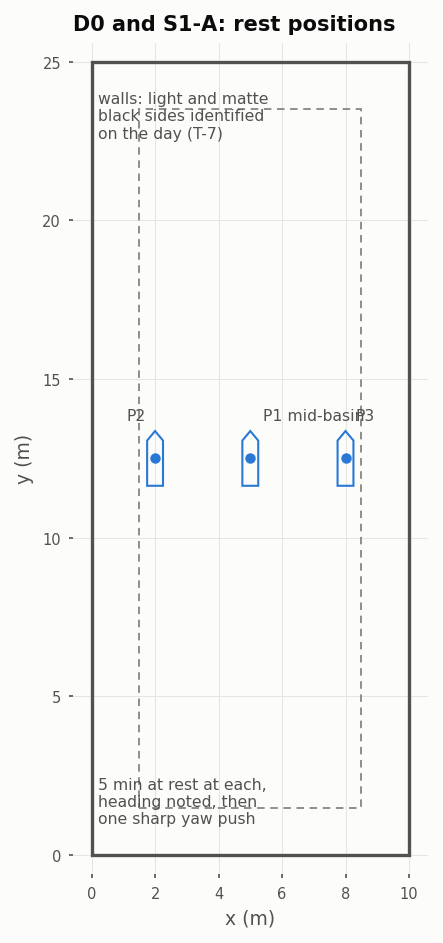

### 4.4 After D0

- `python3 udp_raw_logger.py --check D0-<n>.log` for each log: the kinds, counts and rates by the
  vessel's own time stamps, which answer the rate question for the IMU directly.
- The logs brought back unchanged; then the IMU decoder (B-3), the fit script's reader (P-6) and
  the decisions on P-1 and O-1.

### 4.5 Going on to S1a the same day

S1a starts only if all hold:
- the link ran for 5 min with no gap longer than 1 s;
- IMU lines are present and carry the vessel's time stamps;
- the basin frame is read (D0-5), so `udp_manoeuvre.py` runs with its fence;
- at least 90 min of basin time and a fresh battery set remain.

Otherwise the rest of the booking repeats D0-4 with more variety, which still serves B-3.

## 5. Session S1: identification

The block contents, times, thresholds and dropping order are those of `FIELD_CALIBRATION_PLAN.md`
sections 4, 7 and 8; this section adds the set-up, the procedure and the expected result of each.
The data are fitted after the session on S1 alone, and S2 is kept for validation.

### 5.1 S1a, on D0's day (about 90 min)

**Commands.** By `udp_manoeuvre.py` (B-2) once its first check on the vessel passes: a 10 s
`hold --rpm 6`, then `turn --rpm 6 --rudder 50 --duration-s 5`, which reports the side the vessel
turned to (positive rudder should turn it to starboard; otherwise `--rudder-sign` is reversed and
the check repeated). If the check fails or the vessel-control laptop does not accept `$CMD`, the
blocks run under radio control: the commands are then known only as the logged transmitter
values (in the February logs S1 tracks the throttle and S2 the rudder, about 1467 at centre and
1000 and 1967 at the two full deflections), and the throttle's RPM equivalent comes from its
steady straight speed (0.093 m/s per RPM unit in the current model).

| Block | Time | Procedure | Expected result | Threshold |
| --- | --- | --- | --- | --- |
| S1-A Sensing baseline | 25 min | At rest for 5 min at three marked positions (mid-basin, near the light wall, near the black wall), heading noted; a yaw push at each | gyro bias; localisation drift at rest; LiDAR range noise; return rate against the black wall; the pose reference point (O-9) from the marks | T-7, T-8 |
| Coast-downs | 20 min | `coast --rpm 12 --runup-s 10` and `coast --rpm 9 --runup-s 12`, 3 runs each, started at one end of the basin | model: from 1.12 m/s half speed after 4.7 s, 0.1 m/s after 48 s and 12.8 m; from 0.84 m/s 6.3 s, 47 s, 11.3 m. The first 5-10 s carry most of the drag information; the far wall cuts the tail | (S1-C, T-3 partly) |
| Full-rudder turning circles | 30 min | `turn --rudder 100 --heading-change 720` and `--rudder -100`, at RPM 6 and RPM 12; the run-up along the side opposite the turn (starboard turns along x = 2.5 m, port turns along x = 7.5 m of the 10 m width), so the circle opens across the basin; 2 runs each. RPM 18 only if the RPM 12 circle measured no more than 7 m across (the width inside the fence) | model: radius 5.3 m, 10.0 deg/s at RPM 12 (14.9 deg/s at RPM 18), speed in the turn 0.83 of straight. **The February radio-control turns (`field_deployment/data/test_4.log`) were much tighter:** radius 2.4 m at 0.85 m/s and 3.9 m at 1.34 m/s, both at about 19 deg/s, so the measured circles are expected near those values, not the model's. Within the 10 m width the 2.4 m circle fits (4.8 m across); the 3.9 m one (8.6 m across in February) and the model's would reach the fence and end as arcs | (S1-D, T-4, T-5 partly) |
| First zig-zag | 15 min | `zigzag --rpm 12 --delta 20 --psi 20 --switches 2`, from one end, both initial sides (two switches give the first and second overshoots; four do not fit in 25 m) | model: overshoots 4.8 and 5.2 deg, period 15.9 s; with turns as tight as February's, larger overshoots are likely | (S1-E) |

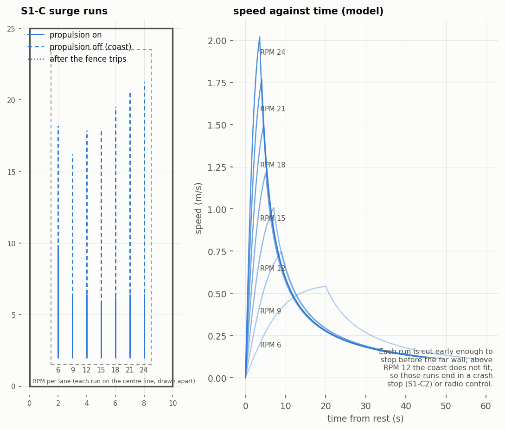

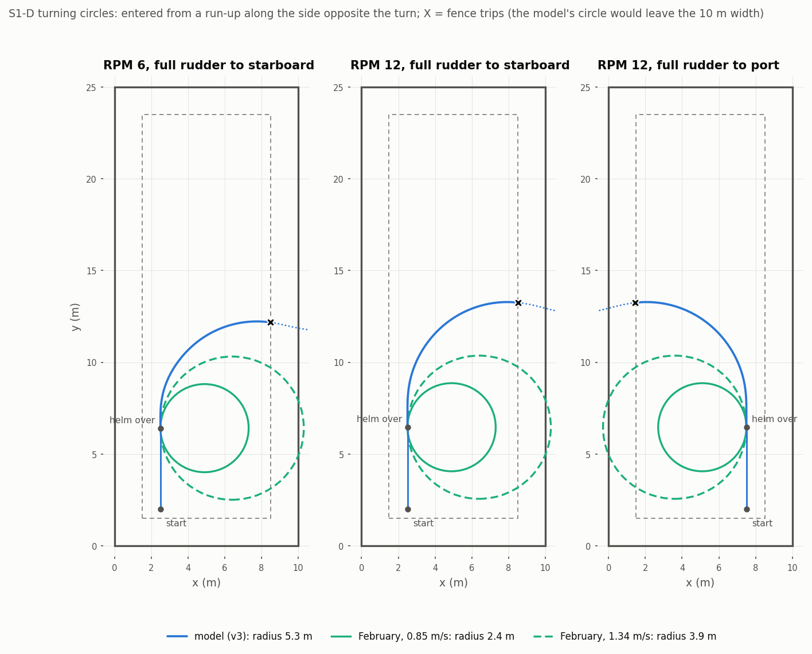

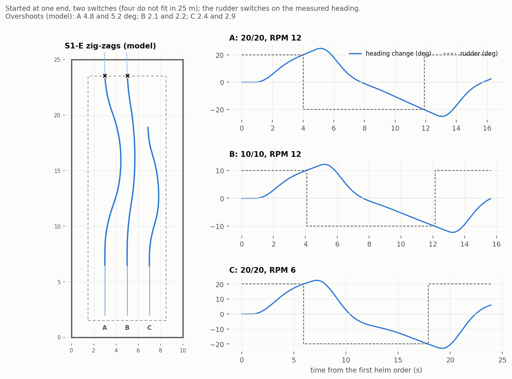

### 5.2 S1b, next booking (about 4 h 50 min)

All blocks by `udp_manoeuvre.py`; the radio-control override ready throughout.

| Block | Time | Set-up and procedure | Varied | Measured | Expected result | Threshold |
| --- | --- | --- | --- | --- | --- | --- |
| S1-A Sensing baseline | 25 min | as in S1a, if not done there, now at surveyed positions (P-7) | position | as in S1a | as in S1a | T-7, T-8 |
| S1-B Actuators | 35 min | `steps --rpm 0 --rudder 25 50 100 --repeats 5 --reversal` with the vessel held at the side (the servo needs no headway), rudder angle from feedback or camera (P-3); then the same at low speed for the yaw response; `ramp --rate 10` | step size: 0 to +/-25, 50, 100 %; +/-100 to -/+100 %; one 10 %/s ramp | commanded and measured rudder angle, yaw rate | model: one lump of 0.73 s transport delay and 0.90 s first-order lag (no effective rate limit); the session separates servo rate, lag and transport delay, so the measured parts may each be smaller than the lump | T-1, T-2 |
| S1-C Surge | 45 min | `hold --rpm R --duration-s T` from rest along the basin, 2 runs each; `coast`, 3 runs each; high-RPM runs short enough to stop before the far wall | RPM 6, 9, 12, 15, 18, 21, 24; coast from 9, 15, 21 | speed against time | model: steady speed 0.56, 0.84, 1.12, 1.40, 1.67, 1.95, 2.23 m/s (linear in RPM; above RPM 12 an extrapolation of the assumed square law); 90 % of it within 4.4 m at every RPM. February's straight runs reached 1.62 m/s | T-3 |
| S1-C2 Crash stops | 30 min | `stop --allow-astern` (full astern, S2 = -100, rudder centred, until the measured speed reads stopped, at most 8 s), from settled straight motion and from a settled turn (`--rudder`); logged to rest; side camera on a marked line. Tests the safety layer's stop (D-4); needs the ESC reverse test (P-8) | RPM 9, 12, 15 straight (3 runs each); RPM 12 turn at helm 50 and 100 %, both sides (2 runs each) | head reach, time to stop, heading change and drift to rest | model, straight from RPM 12: zero surge after 2.1 s and 1.1 m with the strong reverse model (efficiency 0.5, no onset delay), 4.1 s and 2.3 m with the weak one (0.25, 0.75 s onset), both inside T-11's 2.36 m. From a turn the model keeps turning after surge stops (95-162 deg over 60-80 s), because its yaw damping scales with surge speed; the measurement decides whether the real hull does | T-9 to T-13 |
| S1-D Turning circles (priority 1) | 90 min | `turn --heading-change 720`, the run-up along the side opposite the turn; 2 runs per setting. A full circle where it fits inside the fence (full rudder at RPM 6 and 12 on the February evidence); otherwise the largest settled arc, which the fence ends | helm 25, 50, 75, 100 %, both sides, RPM 12; helm 50 and 100 %, both sides, RPM 6; helm 50 and 100 % at RPM 18. A setting whose circle would leave the basin is run as the largest settled arc | steady rate, radius, speed loss, advance, transfer, tactical diameter; asymmetry | model at RPM 12: 2.2, 5.0, 7.7, 10.0 deg/s at helm 25-100 %, radius 28, 12, 7.4, 5.3 m, speed ratio 0.99-0.83; at RPM 6: 2.5 and 5.1 deg/s, radius 12.0 and 5.3 m. These are priors (no sustained turn in the July data); February's full-rudder circles turned about twice as fast (radius 2.4-3.9 m, about 19 deg/s), so the measured values are expected well inside the model's | T-4, T-5 |
| S1-E Zig-zags | 40 min | `zigzag --switches 2`, from settled straight motion at one end of the basin; the rudder switches on the measured heading | 20/20 (3 repeats) and 10/10 (2) at RPM 12; 20/20 at RPM 6 (2); both initial sides | first and second overshoot, period | model: 20/20 at RPM 12 overshoots 4.8 and 5.2 deg, period 15.9 s; 10/10 2.1 and 2.2 deg, 16.0 s; 20/20 at RPM 6 2.4 and 2.9 deg, 24.4 s. Up to the second overshoot the vessel runs 13.8 m at RPM 12 (10.1 m at RPM 6), about 20 of the 25 m with the run-up | T-6 |
| S1-F Mid-session check | 25 min | The committed fit script on the day's data | - | thresholds of section 7 of the calibration plan | anything failing is reshot before the session ends | all |

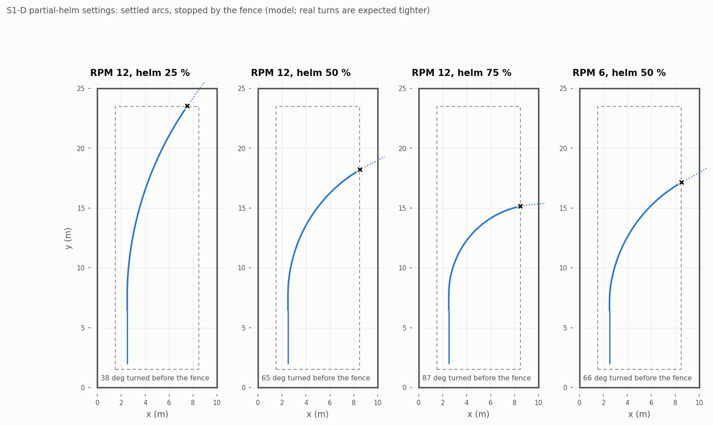

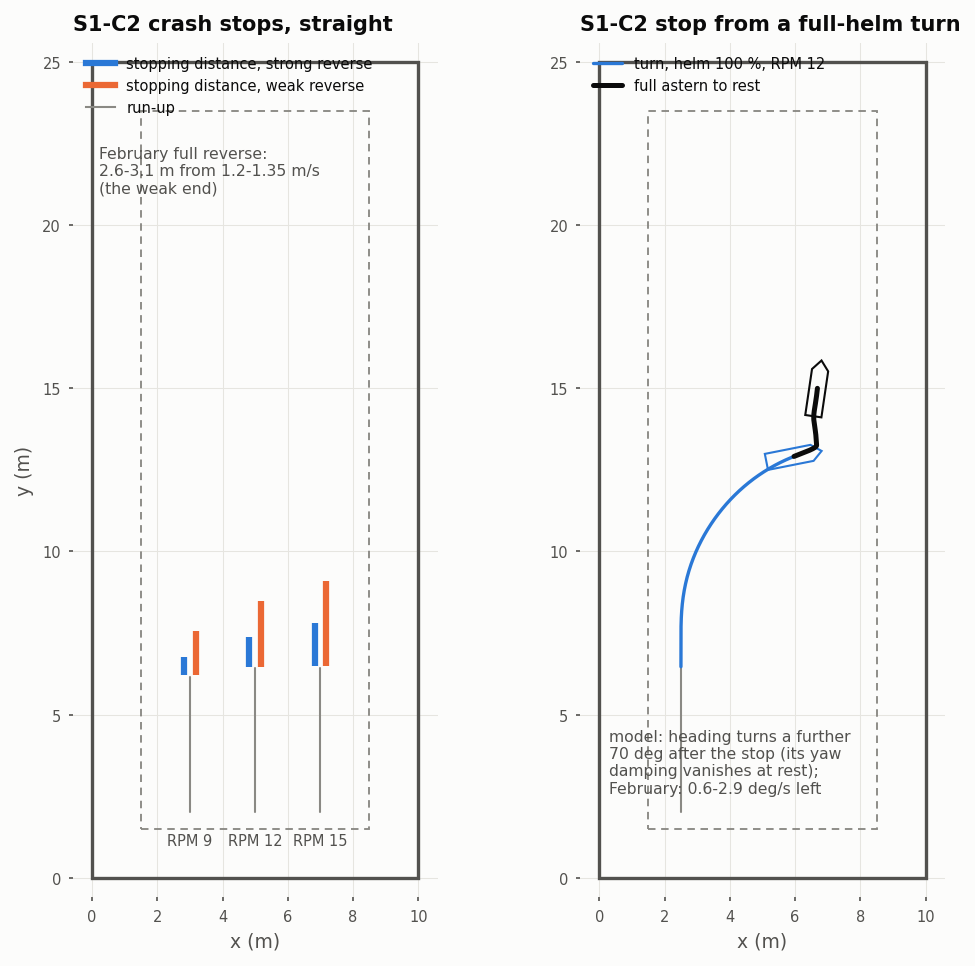

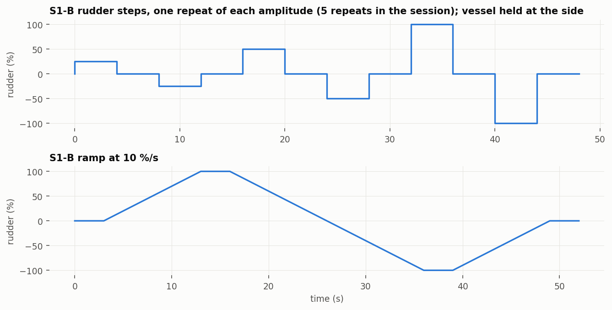

### 5.3 Back-up by radio control

Used only when `udp_manoeuvre.py` cannot command the vessel on the day (its first check fails, or
the vessel-control laptop does not take `$CMD`). The operator drives with the transmitter; the log
holds the stick positions only as the `RC` lines at about 1 Hz (in the February logs S1 tracks the
throttle and S2 the rudder). Radio-control data therefore give steady-turn, drag and stopping
quantities, not actuator timing, and they count as identification data only with those lines in
the log.

| Test | Route | Procedure | Yields |
| --- | --- | --- | --- |
| RC-1 Straight runs and coast | along the centre line from one end | steady throttle (stick held) for 9-10 s, then throttle to zero; 3 runs at each of two settings | the steady speed per throttle setting (its RPM equivalent) and the drag from the coast |
| RC-2 Full-rudder circles | run-up along the side opposite the turn (x = 2.5 m for starboard, 7.5 m for port), stick to full rudder at about y = 9 m | two full turns with the stick held at full deflection, then centred; 2 runs each side; throttle no higher than February's first circle (0.85 m/s, a 2.4 m radius, 4.8 m across) | steady turn rate, radius and speed loss at full rudder |
| RC-3 Rest positions | the S1-A marks | as S1-A | as S1-A |
| RC-4 Full-reverse stops | straight run as RC-1, then full reverse stick | only after the ESC reverse is confirmed (P-8); 3 runs | stopping distance and time (February: 2.6-3.1 m from 1.2-1.35 m/s) |

Not done by radio control: rudder steps (the actuator needs exact command times), zig-zags (the
switch on the measured heading cannot be made by eye) and partial-helm arcs (the stick position is
not repeatable).

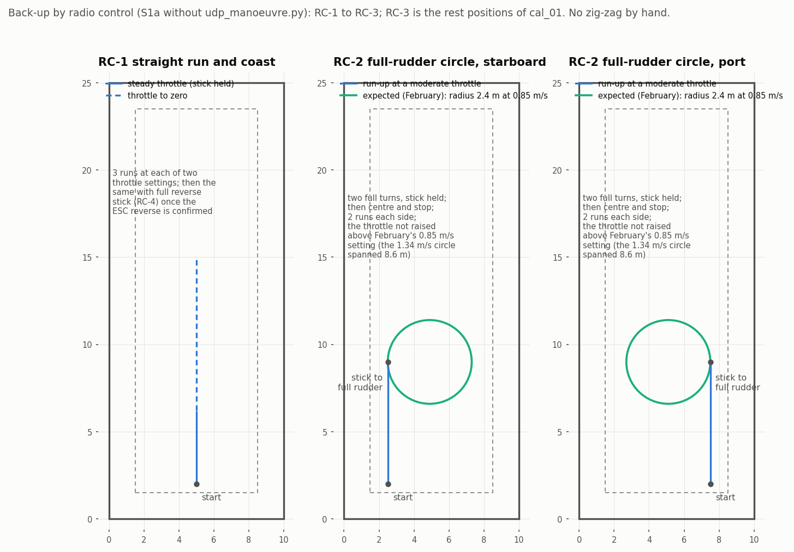

## 6. Session S2: validation and dress rehearsal (about 4 h)

No refitting in this session: its data validate the S1 model.

| Block | Time | Set-up and procedure | Measured | Expected result | Threshold or check |
| --- | --- | --- | --- | --- | --- |
| S2-A Repeatability | 45 min | Without refitting: arcs at helm 50 and 100 %, one surge point, one 20/20 zig-zag | the same quantities as S1 | within S1's run-to-run spread; the difference between days gives the randomisation width to compare with training | day-to-day variation reported |
| S2-B Open-loop replay | 45 min | Fixed command sequences from S1 and from the policy (`udp_manoeuvre.py sequence`), no feedback; three crash stops at RPM 12 as holdout | heading and position error against horizon, model against measurement | the S1 model at least as good as the July holdout figures (heading 7.9 deg at 3 s, position 0.26 m at 3 s) | as `bluefin/REPORT.md` V1 |
| S2-C Closed-loop dress rehearsal | 80 min | The deployed policy through the Paper 3 bridge (`udp_live_p3.py`, shadow mode, registered map frame), no target; layouts L1, L2, L3 and the open leg, 2 runs each | outcome, cross-track error, clearances, tracks; each run re-simulated from its logged start | goal reached without contact; no moving track at all, since no target is on the water (in the July logs, before map registration, 42 % of decisions carried one) | T-15; trial procedure, reset and abort rehearsed |
| S2-D Target platform | 40 min | The target measured (outline, the pipe's position on it); driven straight at 4-5 throttle settings, 2 runs each; the own ship at rest while the target passes at 2-8 m | the target's speed per throttle setting and its straightness; LiDAR returns from the pipe against range; the tracker's track against the target's measured path | a speed table covering the trial speeds 0.23-0.98 m/s; whether the tracker accepts the pipe's small cluster (its gates assume a 1.73 x 0.50 m hull, D-1) | input to B-4 and B-7 |
| S2-E Contingency | 30 min | unallocated; recovers a lost S1 block at the cost of S2-C | - | - | - |

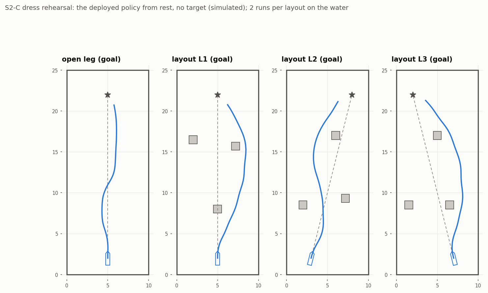

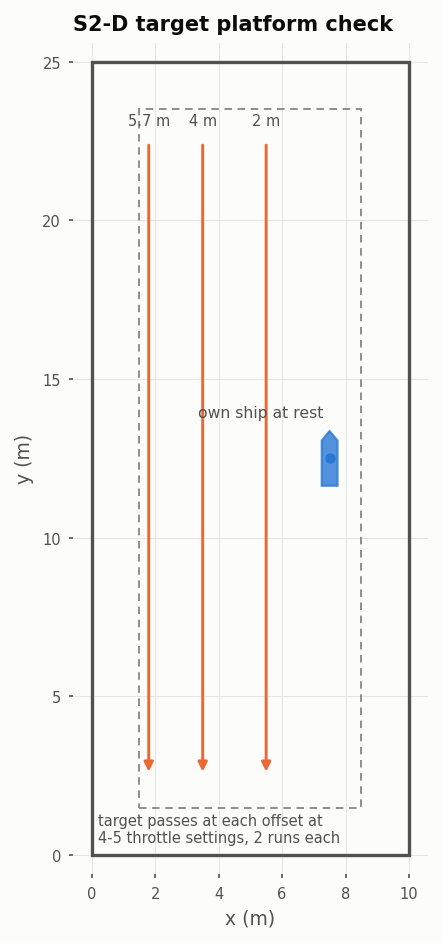

## 7. Trials: common set-up

- **Fixed configuration** of `FIELD_TRIALS_PLAN.md` section 2: the deployed policy (SAC seed 0),
  2 Hz decisions, cruise RPM 6 (0.56 m/s), E1 in shadow mode, the operator stop armed, the
  registered map frame. The bridge loads the case by name:
  `python udp_live_p3.py --scenario easy_1 --server-ip <vessel-control IP> --run-id T1-easy_1-r1`.
- **Start:** both ships from rest at their marks; the target released at its offset from the own
  ship's release (section 7.1 and the case tables). The field sheet (`python src/field_test_cases.py sheet <case>`) gives the
  points, headings and target speed.
- **Run validity:** own start within 0.2 m and 5 deg of the mark and target launch within 1 s of
  its time (the perturbations of the simulated robustness runs); target speed within 0.05 m/s and
  on its line within 0.5 m until the closest approach (proposed, to confirm at S2-D). A run outside these is kept, flagged invalid and
  repeated if time allows.
- **Order:** in rounds, every case once per round, the order of each round changed, so a lost
  hour leaves every case with runs and slow changes (battery, water) do not fall on one case.
- **Measured per run:** outcome (goal, contact by type, operator stop, timeout); minimum target
  range and DCPA; passing side; first alteration (side, size, time after the target is first
  tracked); speed change; cross-track error; the shadow layer's would-change decisions and stops;
  tracker error against ground truth (D-2); trajectory snapshot (`FIELD_TRIALS_PLAN.md` section 6).
- **Encounter behaviour** is shown by trajectory snapshots and described against the rule
  conditions of Section 3.4.3 (COLREGs-aware behaviour, no per-rule compliance table).
- About 6-8 min per run including reset.

### 7.1 Starting from rest, in simulation and on the water

On the water both ships start from rest at their marks. The suite was verified with both already
moving at t = 0, the scenario generator's convention (its backward solve places the target for an
own ship at cruise). The field cases are therefore simulated as they will be run:

- the own ship from rest at its mark, the policy acting from its release (the policy met such
  starts in training: 15 % of training episodes began slow, half of them from rest, and from rest it
  reaches 90 % of cruise in a median 4.5 s, throttling up to RPM 12);
- the target from rest at its mark, accelerating as u(t) = v tanh(t / tau), tau = 5.29 s m/s / v
  (the Bluefin plant's own acceleration, a stand-in until S2-D measures the target);
- the target released at an offset from the own ship, chosen per case on 3 seeds as the offset
  (-20 to +10 s, 1 s steps) that best reproduces the designed encounter: the closest range and the
  own ship's position along the leg at the closest approach in the run at cruise. The choice is by
  geometry, never by success; a formula from the two ships' lags disagreed with the chosen offsets
  by up to 16 s, so the offset is set per case.

Simulated before (released together at t = 0, both moving) and with both from rest, 10 seeds each,
identified plant: 12 of 15 cases reach the goal on 10 of 10 seeds from rest; `easy_2` 8/10, `medium_2` 9/10, `medium_4` 9/10.

**`medium_3` re-picked (2026-11-24).** The first `medium_3` (L1, crossing from port) reached the
goal on only 2-4 of 10 seeds from rest, so its cell was searched again under this protocol
(`tools/tiers/field_suite_repick.py`; the cell's 4 kept candidates and 400 new draws). Two
candidates reached 10/10 from rest; the suite's rule (most robust from rest, then the rule
conditions, then the smallest DCPA) took generator seed 980324: 10/10 from rest and 10/10 robust
from rest (randomised plant, perturbed start, release within 1 s). It does not meet the stand-on
conditions: it turns to starboard and crosses ahead of the target. No candidate in the cell does
both: the three rule-consistent ones reached 1-5 of 10 from rest. The offsets and the from-rest results per case are in the tables of sections 8-10;
the routes in the figures. The release offset is part of each run's sheet, and a run released more
than 1 s off it is invalid.

**Test set v4.** Its figures stay the simulation result of Section 4, under the stated convention
(both ships moving at t = 0), and no learner is retrained: training already included starts from
rest (15 % of training episodes began slow, half of those from rest), and the comparison between
learners was made under one convention. The field-facing simulations (these cases, the
closed-loop twins, which start from each run's logged state, and the expected results) all start
from rest. No from-rest re-evaluation of the test set is planned (decision 2026-11-24).

## 8. Session T1: target only, open basin (about 4 h)

Open basin, no panels; leg (5, 2) to (5, 22); the target alone.

| Block | Time | Content |
| --- | --- | --- |
| T1-0 Readiness | 30 min | section 2.4 checks; registered map frame checked on the landmarks; one target run per trial speed to confirm the speed table; abort rehearsed with the target |
| T1-A No-target baseline | 15 min | the open leg, 2 runs, as a same-day baseline for path keeping and phantom tracks |
| T1-B Encounters | 2 h | `easy_1` to `easy_5`, 3 rounds (15 runs) |
| T1-C Extra repeats | 45 min | a 4th and 5th round if time allows, else repeats of invalid runs |
| Contingency | 30 min | - |

**Cases and expected results** (simulation: deployed policy, 10 noise seeds on the identified
plant; robustness with a randomised plant and perturbed starts and launches):

| Case | Encounter (rule) | Target: start, heading, speed | Simulated: goal nominal / robust | Closest approach in simulation | Expected behaviour (nominal simulated run) | Both from rest: release; goal; closest approach (median) |
| --- | --- | --- | --- | --- | --- | --- |
| `easy_1` | head-on (14) | (4.69, 16.01), 181.1 deg, 0.57 m/s | 10/10, 10/10 | 1.17 m, 12.4 s after t = 0 | alteration to starboard, port-to-port passing; rule conditions met | target 5 s before own ship; 10/10; 3.16 m |
| `easy_2` | crossing, target to starboard, own ship gives way (15, 16) | (8.63, 6.29), 292.1 deg, 0.52 m/s | 10/10, 10/10 | 2.40 m, 9.0 s | gives way without crossing ahead of the target; rule conditions met | target 8 s after own ship; 8/10; 2.33 m |
| `easy_3` | crossing, target to port, own ship stands on (17) | (1.70, 10.03), 119.4 deg, 0.57 m/s | 10/10, 10/10 | 1.90 m, 8.8 s | holds course and speed; rule conditions met | target 10 s before own ship; 10/10; 1.95 m |
| `easy_4` | overtaking (13) | (7.16, 8.07), 354.6 deg, 0.25 m/s | 10/10, 10/10 | 2.89 m, 20.3 s | passes the slower target clear; rule conditions met | target 11 s before own ship; 10/10; 2.84 m |
| `easy_5` | being overtaken, own ship stands on (13) | (3.94, 4.62), 358.9 deg, 0.93 m/s; own ship starts at (5.0, 8.9) | 10/10, 10/10 | 1.68 m, 11.3 s | holds course and speed while the target passes; rule conditions met | target 3 s after own ship; 10/10; 1.80 m |

**Reading the results.** Each field run is compared with its closed-loop twin (the same start and
the target's measured track, re-simulated; `FIELD_TRIALS_PLAN.md` section 7): outcome agreement,
and each metric against the twin's spread. A difference the calibrated model reproduces and the
training model does not lies in the dynamics; otherwise in perception, localisation or
disturbance.

**Session result needed:** at least 2 valid runs of each case.

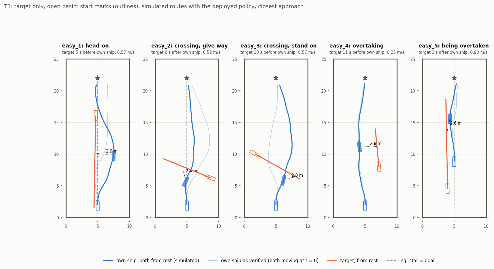

## 9. Session T2: target and static obstacles, layout L1 (about 4 h)

Layout L1, Paper 2's three 1 m panels at (5.0, 8.0), (7.2, 15.7), (2.0, 16.5), placed on the
surveyed marks; leg (5, 2) to (5, 22).

| Block | Time | Content |
| --- | --- | --- |
| T2-0 Readiness and layout | 40 min | section 2.4 checks; panels placed and checked against the map; target speed check |
| T2-A No-target run on L1 | 15 min | 2 runs: path keeping past the panels, phantom tracks |
| T2-B Encounters | 2 h | `medium_1` to `medium_5`, 3 rounds (15 runs) |
| T2-C Extra repeats or start of T3 | 45 min | repeats of invalid runs, or the L3 cases if the layout change fits |
| Contingency | 20 min | - |

| Case | Encounter (rule) | Target: start, heading, speed | Simulated: goal nominal / robust | Closest approach | Expected behaviour (nominal simulated run) | Both from rest: release; goal; closest approach (median) |
| --- | --- | --- | --- | --- | --- | --- |
| `medium_1` | head-on (14) | (5.18, 20.64), 174.0 deg, 0.68 m/s | 10/10, 10/10 | 3.72 m, 15.1 s | turns to port first (the panel at (5, 8) sits on the leg and hides the target until 7.5 m) and passes starboard to starboard; rule conditions not met | target 3 s before own ship; 10/10; 4.00 m |
| `medium_2` | crossing, target to starboard (15, 16) | (7.73, 8.95), 221.1 deg, 0.40 m/s | 10/10, 10/10 | 2.36 m, 8.3 s | turns to port and crosses ahead of the target (the target is first tracked at 5.7 m); rule conditions not met | target 4 s before own ship; 9/10; 2.63 m |
| `medium_3` | crossing, target to port (17) | (2.32, 9.00), 143.8 deg, 0.34 m/s | 10/10, 8/10 | 2.80 m, 8.7 s | turns to starboard first and crosses ahead of the target; rule conditions not met (re-picked 2026-11-24 for the start from rest, section 7.1) | target 7 s before own ship; 10/10; 2.86 m |
| `medium_4` | overtaking (13) | (6.87, 7.88), 352.6 deg, 0.29 m/s | 10/10, 10/10 | 2.76 m, 22.2 s | passes the slower target clear; rule conditions met | target 7 s before own ship; 9/10; 2.94 m |
| `medium_5` | being overtaken (13) | (4.03, 4.11), 357.3 deg, 0.98 m/s; own ship starts at (5.0, 10.0) | 10/10, 10/10 | 4.50 m, 13.6 s | stands on; rule conditions met | target 7 s after own ship; 10/10; 5.97 m |

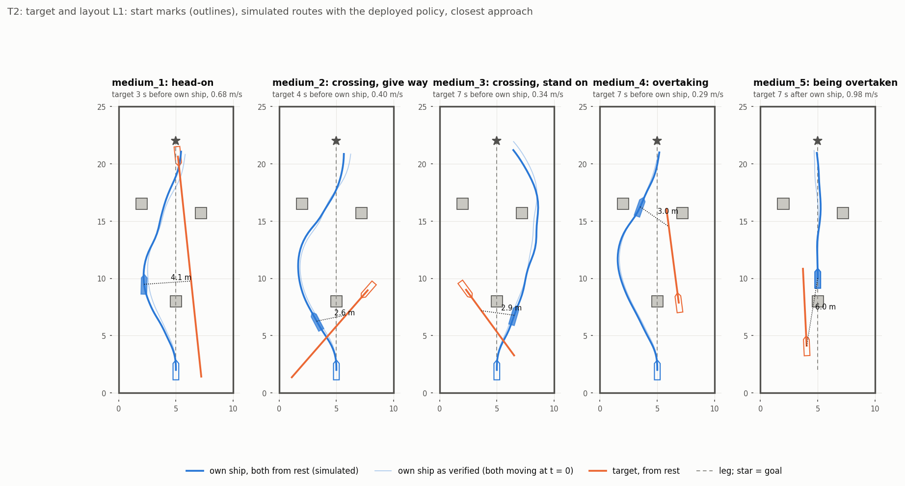

## 10. Session T3: target and static obstacles, layouts L3 and L2 (about 4 h)

L3 panels at (1.5, 8.5), (6.5, 8.5), (5.0, 17.0), leg (7, 2) to (2, 22); L2 panels at (2.0, 8.5),
(7.2, 9.3), (6.0, 17.0), leg (3, 2) to (8, 22). L3 first (three cases), then one layout change.

| Block | Time | Content |
| --- | --- | --- |
| T3-0 Readiness and L3 | 40 min | checks; L3 placed |
| T3-A L3 | 1 h 30 min | 1 no-target run; `hard_1` to `hard_3`, 3 rounds (9 runs) |
| T3-B L2 | 1 h 15 min | layout change (15 min); 1 no-target run; `hard_4`, `hard_5`, 3 rounds (6 runs) |
| T3-C Repeats | 35 min | runs missing from T1 or T2 (their layouts permitting), invalid runs |

| Case | Layout | Encounter (rule) | Target: start, heading, speed | Simulated: goal nominal / robust | Closest approach | Expected behaviour (nominal simulated run) | Both from rest: release; goal; closest approach (median) |
| --- | --- | --- | --- | --- | --- | --- | --- |
| `hard_1` | L3 | head-on (14) | (3.97, 16.30), 171.5 deg, 0.57 m/s | 10/10, 10/10 | 3.08 m, 13.0 s | rule conditions met | target 4 s before own ship; 10/10; 3.17 m |
| `hard_2` | L3 | crossing, target to starboard (15, 16) | (6.58, 11.65), 207.1 deg, 0.40 m/s | 10/10, 10/10 | 2.78 m, 10.7 s | rule conditions met | target 4 s before own ship; 10/10; 2.87 m |
| `hard_3` | L3 | crossing, target to port (17) | (2.87, 9.70), 153.9 deg, 0.49 m/s | 10/10, 10/10 | 3.10 m, 8.3 s | rule conditions met | target 4 s before own ship; 10/10; 3.21 m |
| `hard_4` | L2 | overtaking (13) | (4.77, 10.65), 23.5 deg, 0.23 m/s | 10/10, 10/10 | 3.35 m, 26.3 s | rule conditions met | target 10 s before own ship; 10/10; 3.48 m |
| `hard_5` | L2 | being overtaken (13) | (3.69, 4.55), 21.5 deg, 0.94 m/s; own ship starts at (4.67, 8.70) | 10/10, 10/10 | 3.33 m, 10.3 s | does not hold its speed while being overtaken (lateral departure 0.74 m, inside the 1 m allowed); rule conditions not met | target 1 s before own ship; 10/10; 3.34 m |

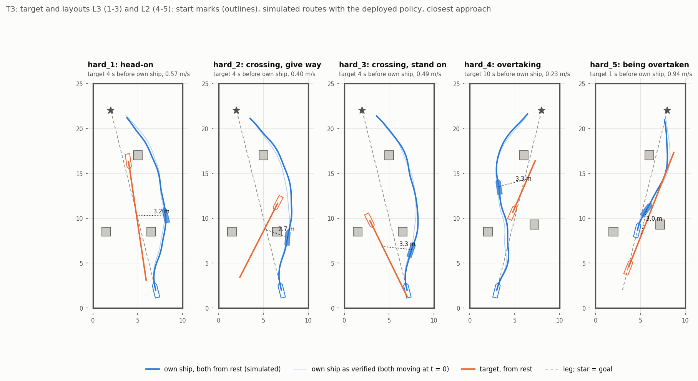

**An optional active-layer block** (E1 in the command path, D-4) runs only if the layer meets
T-14 on the shore laptop and the ESC reverses (P-8); it would follow T3-C on the hardest cases.

## 11. When a session runs short

- **D0:** D0-1, D0-2 and D0-5 are never dropped; D0-3 goes first, then D0-4 is shortened.
- **S1a:** the zig-zag goes first, then the coast-downs; the sensing baseline and the circles stay.
- **S1, S2:** the dropping order of `FIELD_CALIBRATION_PLAN.md` section 8; a lost S1 block is
  recovered in S2-E, never by fitting on S2 data.
- **Trials:** the last round is dropped first, so each case keeps the runs already made; then
  T1-C, T2-C and T3-C. Each case keeps at least 2 valid runs; a case with fewer moves to the
  next session.

## 12. After each session

- Logs, run sheet and video copied off the session computers the same day, unchanged.
- A short session record: blocks done, runs per block (valid, invalid), deviations, battery,
  basin conditions, anything that changes the next session.
- The status of this file, of the open items in both design plans and of `00_CURRENT_STATE.md`
  updated.
